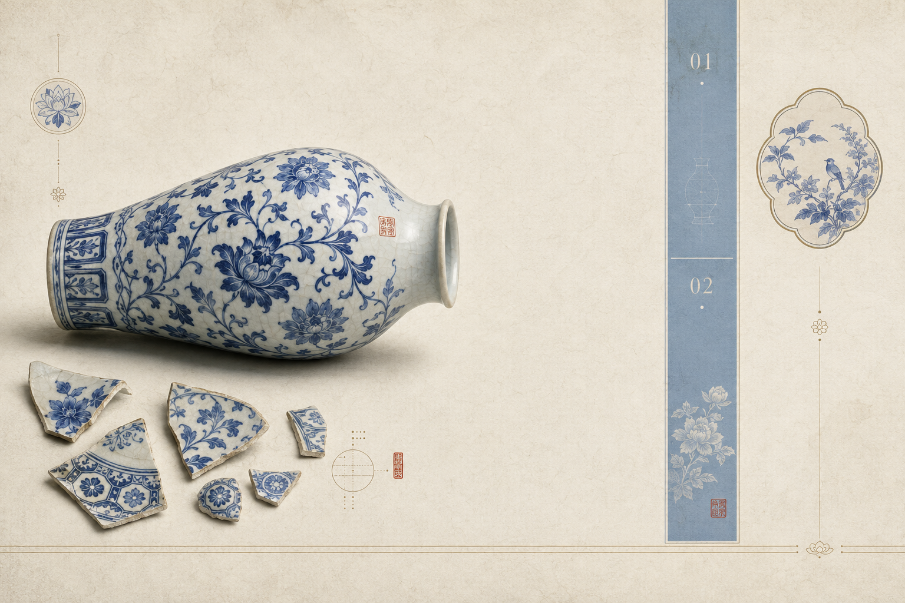

# img-antiquity

**中国古典水墨卷轴 × 现代杂志编辑设计** — 一个可复用的东方文化图像生成风格提示词（Skill），让任何图像生成模型输出博物馆展览图录级的文化视觉。

Chinese Classical Ink Scroll × Modern Magazine Editorial — a reusable image-generation style prompt (Skill) that produces museum-catalog-grade cultural visuals with any mainstream image model.

## 效果展示 / Examples

<p align="center">
  
  
</p>

左：刺绣主题 · 杂志封面（宋绣/苏绣/蜀绣）　右：青花瓷主题 · 展览图录跨页（明宣德青花）

## 特性 / Features

- **即插即用**：`§0 快速开始` 提供可直接粘贴的整合版提示词，无需阅读全篇
- **参数化变量**：主题 / 用途 / 画幅 / 元素 / 版式 / 强调色 / 文字区域 / 细节密度，8 个变量自由组合
- **严格负面词**：分组负面提示词，防塑料感、防国潮廉价感、防文字乱码
- **主题变体公式**：内置刺绣、瓷器两个完整示例，其他工艺主题（玉器、漆器、书画…）按同一公式推导
- **AI Skill 格式**：`SKILL.md` 可直接被 Claude Code、QoderWork 等支持 Skills 的 AI 工具加载，自动组装提示词
- **中英双语**：中文原版 + 英文版，适配 Midjourney 等对中文支持有限的平台

## 目录结构 / Structure

```
img-antiquity/
├── SKILL.md                        # AI Skill 主文件（给 AI 读的操作手册）
├── prompts/
│   ├── antiquity-prompt-zh.md      # 中文版完整提示词（12 章节 + 2 主题变体）
│   └── antiquity-prompt-en.md      # 英文版完整提示词
├── examples/                       # 提示词生成效果示例
│   ├── embroidery-aesthetic-cover.png
│   └── porcelain-catalog-spread.png
└── docs/
    └── antiquity-prompt.pdf        # 设计文档原稿（PDF）
```

## 快速开始 / Quick Start

### 方式一：手动使用（任何图像平台）

1. 打开 [中文版](prompts/antiquity-prompt-zh.md) 或 [英文版](prompts/antiquity-prompt-en.md)
2. 复制 `§0 快速开始` 的整合版提示词
3. 按 `§10 变量模板` 追加你的主题、用途、画幅等参数
4. 按用途追加文字处理指令，最后追加 `§9` 负面提示词
5. 粘贴到 Midjourney / Stable Diffusion / DALL·E / 即梦 / 通义万相 等平台生成

示例（组装后的完整提示词）：

```
中国古典水墨卷轴与现代高端杂志编辑设计融合的东方视觉风格……（§0 整合版）
主题：苏绣团扇　用途：封面　画幅比例：A4 竖版　主要视觉元素：花鸟、器物
版式倾向：中轴分栏　主强调色：朱红　细节密度：中
不生成任何可读文字，保留干净标题区和正文排版区，所有正式文字后期添加。
避免：现代霓虹色、赛博朋克、卡通、廉价国潮、元素拥挤、乱码……（§9 负面词）
```

### 方式二：作为 AI Skill 使用

将本仓库放入你的 Skills 目录（如 `~/.claude/skills/`、QoderWork 的 skills 目录），AI 会在你描述"想要一张水墨杂志风封面"时自动加载 `SKILL.md` 并为你组装提示词。

## 兼容平台 / Compatible Platforms

Midjourney、Stable Diffusion（SDXL / Flux）、DALL·E、即梦、通义万相、文心一格等主流图像生成模型。英文提示词版本对英文优先的平台效果更稳定。

## 许可 / License

[MIT](LICENSE)

## 致谢 / Credits

风格体系整理与示例图由 [grape-dot](https://github.com/grape-dot) 制作。示例图由 AI 图像模型依据本提示词生成，可自由用于项目展示与个人创作。
