# rice-paper-ppt

**米纸质感 HTML 幻灯片** — 一套「暖米纸 + 深林绿 + 哑光金」的中文演示文稿规范（Skill），
视觉层固化纸感配色、衬线大标题、投影级字号与逐页版式验收，
文案层固化标题、句式、术语与标点规范，让 Agent 直接产出可讲、可投影、可离线分发、
语言严谨的 HTML 幻灯片。

**它是一套规范，不是一个用途。** 汇报、路演、方案宣讲、复盘、培训、分享会、
文化展陈、课程——凡是需要在屏幕上讲、且希望它看起来像一本装帧考究的册子，都适用。

A warm rice-paper HTML slide style — 16:9, 1280×720, forest green and matte gold with
serif display type, projection-scaled typography, a writing-style spec, and a Playwright layout audit.

<p align="center">
  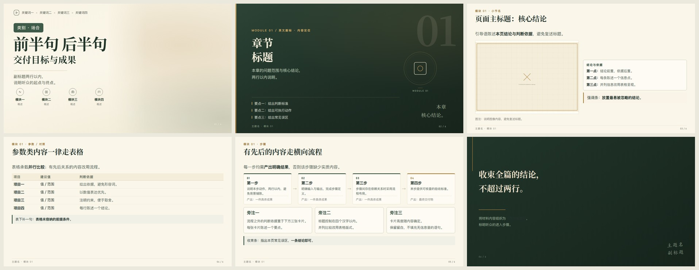
</p>

上排：封面 · 章节分隔 · 图文案例　下排：表格对比 · 横向流程 · 结语

## 特性 / Features

- **风格统一、用途不限**：一套 token 管住全篇气质；换主题只需改 `--paper` / `--green` / `--gold` 三个值。
- **投影级字号**：正文 21px 起（`--fs-body`），表格 18/20px，代码 18px，页脚 13px。
  不用「缩小字体塞内容」换空间，放不下就改结构。
- **一支文件即成品**：`index.html` + `theme.css` + `deck.js` + `assets/`，双击就能讲，
  不依赖网络、不依赖构建、不需要 Office。
- **六页可运行骨架**：封面 / 章节 / 图文 / 表格 / 流程 / 结语，改文案即成片，不从空白页写起。
- **十五种版式配方**：按「页面作用」选版面，相邻页强制换版式，避免通篇卡片网格。
- **多图排版十五式**：齐边错落式讲并列（1，4–5 张照片卡上下错位）、波浪贯通式讲连续（2，4 张通栏大 S 只起伏一次）、
  纵深渐进式讲层进（3，8 张沿垂直轴旋转，右缘贴边、近大远小）、不对称叶片式讲收束（4，一条遮罩裁出左厚、中小、右回升）、
  螺旋长卷式讲一段有起点的历程（5，7 块沿一条带子盘绕，可拉满整页通栏或收进内容页右列）、
  半圆扇面式讲聚拢（6，扇骨即放射接缝）、弧形切幅式讲延伸（7，上缘一条弧左低右高）、
  矩阵网格式讲秩序（8，5×3 十五格卷成圆柱面）、折页长卷式讲折页展开（9，四片共边梯形）、
  弧幕连屏式讲环幕（10，内弧 11 反向聚焦中央）、峰谷天际线式讲压轴（12，九扇底边对齐、
  高度对称起伏、正中深色主塔拔起）、四季弧线式讲时间（13，整面贝塞尔弧裁出左薄右厚、远小近大、顶弧金节点）、弧形内凹式讲柔和收放（14，上下缘反向弧线、中腰收拢两侧舒展）、斜切折页式讲展开（15，六扇竖幅底边两段斜切向中央折脊收拢、中脊下漏斗托图注）。墙内等宽白缝、不逐图配卡；立体感来自暖白拼缝、
  沿轮廓投影、边缘顶亮底暗与尺寸错落，不用发光和玻璃。`theme.css` 已内置十五式、标题带与 0.7s 入场动画，
  十五式的实拍、单格尺寸与横图裁切顺序见下文「图片墙十五式」。
- **按图片个数选骨架**：十五式按「内容关系」定母题，个数是另一维——
  一页放几张图（1–10 张与超多图）就查 `references/image-count-layouts.md` 的速查表，
  每档给首选骨架（两个变体）、文字配比、适配主题与米纸落地法；1–3 张与超 10 张
  不在十五式覆盖区间，各有独立骨架。
- **可选增强层**：HTML 是载体，不是能力上限。`assets/fx.js` 只在检测到 GSAP 时才接管编排
  （图墙浮起 / 叶片逐张 / 纵深转正），没有 GSAP 就自动退回纯 CSS，不多一个依赖；
  需要真实顶点位移或网格 warp 时，用 `data-fx` + `RP.fx.register` 挂 WebGL / Canvas，
  返回清理函数即可在离页时销毁上下文。约束的是交付物——静态可回退、依赖本地化、
  打印与截图回到终态——不是技术选型。
- **页码「当前 / 总页」**：正文、章节页、封面、结语四处统一格式，`deck.js` 按 DOM 顺序自动回填，不会逐段漂号。
- **章节首页是深绿章板**：底色一重，翻章立刻能感觉到；板上放大编号 + 本章徽记（印章圆环 + 单色线稿），
  图案就是这一章要讲的东西。七个现成图标可复制，品牌工具（Remotion 等）可放官方图标改单色。
  开工前会先问一次：默认由 AI 设计，还是你出创意。
- **文案语言规范**：`references/copywriting-spec.md` 约束标题命名、句式、正文结构、术语口径与标点，
  禁用机械化对比句式、口语化引导语与空泛营销表达。
- **信息结构规范**：`references/content-structure-spec.md` 约束专业术语提炼、信息层级重构、内容压缩、
  章节封面定位与信息可视化，禁用「两条链 / 几个步骤」等模糊代称；成稿后语言审查（第 08 节）与
  结构审查（A–H）双轨执行，骨架示例文案已按两份规范改写。
- **可验证的验收**：`scripts/audit.js` 用 Playwright 逐页真实渲染，检出内容溢出、越界、
  静默裁切、容器内溢、过小字号五类问题，返回退出码可当 CI 闸门。
- **样式单点控制**：所有字号 / 间距都是 `:root` 里的 CSS 变量，整体放大缩小改一处即可。
- **完整交互**：方向键 / Home / End / 数字键翻页、`f` 全屏、`p` 打印、`#N` 深链、
  窗口自适应等比缩放、视频播放与声音开关，视频自带暂停按钮与可拖拽进度条（`.vctl` 自动挂载）。

## 图片墙十五式 / Wall patterns

一组同题材图并置时，先定几何母题、再抬起整组。1–4 式共用一套做法：容器一条 `clip-path`
（或一个 `perspective`）决定外轮廓，墙内等宽、2–3px 暖白缝，投影沿轮廓落下。
5 式换几何语言：一条内联 SVG 里七块各裁各形、各填各图，白缝靠同一批 path 再描一遍。
6–11 式是立体曲面一组：扇面（6）从同一个圆心拉出扇骨，切幅（7）只弯上缘，
网格（8）整面朝观众卷进来，折页（9）与弧幕（10 / 11）用共边梯形拼出连续折面——
这一组的立体感大头是光（受光差、折缝一亮一暗、贴地影），不只是形变。
12 又回到平面：九扇竖幅底边对齐排成一行，高度对称起伏成峰谷，戏剧性全在高差与
正中那扇深色主塔上——主塔是全页唯一的深色块，也是视线落点。

下面 12 张都是 1280×720 的整页实拍，不是拼图：标题即式名，标题下那句就是这一式的形态定义，
其余部分全是这一式的真实渲染。1–4 式用同一组四张约 3:2 的横构图素材（`examples/img/vg1–vg4.jpg`），
所以裁切差异可以直接对比。

**01 齐边错落式** — 多张图片独立排列，通过上下错位形成节奏感。

<p align="center">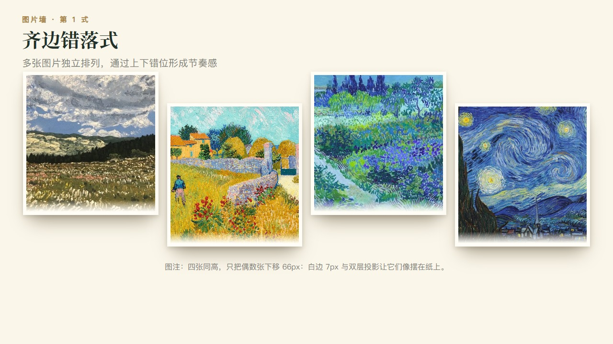</p>

**02 波浪贯通式** — 多张图片沿连续波浪曲线拼接，形成整体画面。

<p align="center">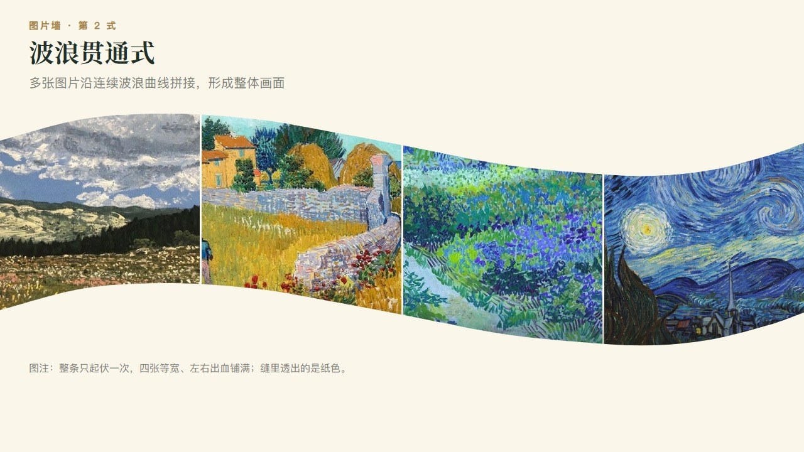</p>

**03 纵深渐进式** — 图片按纵向层次递进排列，营造空间纵深感。

<p align="center">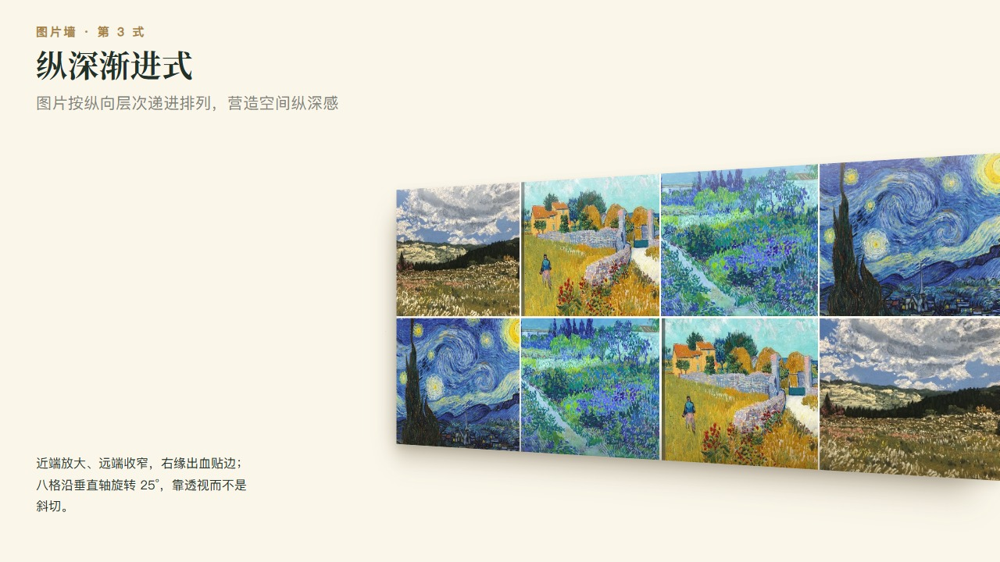</p>

**04 不对称叶片式** — 图片以不对称弧形边缘连接，形成叶片般的视觉效果。

<p align="center">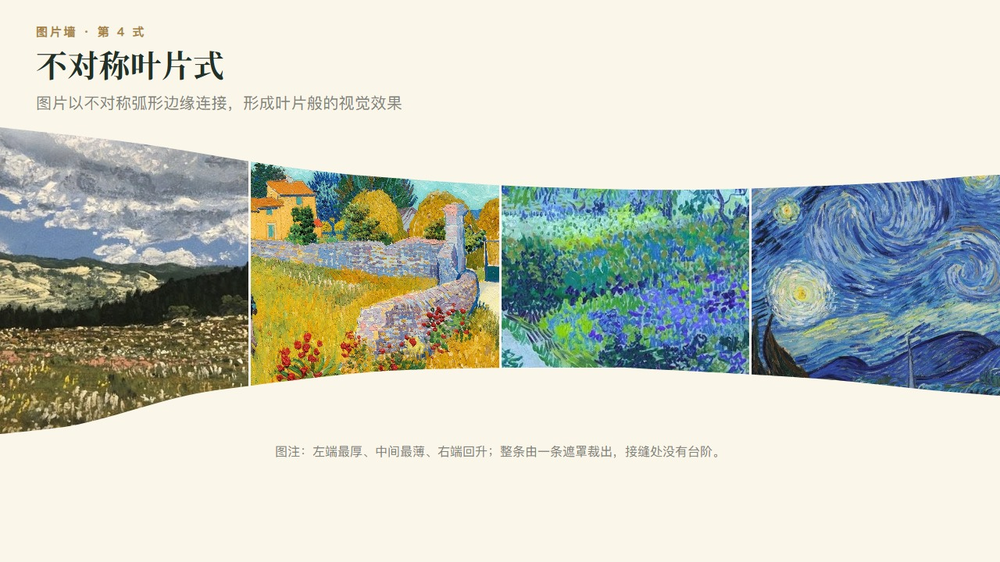</p>

同一组素材在 1–4 式下的裁切差异一眼可见：3 的格子最接近原比例、几乎不裁，
1 保留 67%，2 / 4 的竖格只留 57%。

5 不是「摊开」而是「走进去」：带子绕一圈半，七块从顶部横带一路盘到右下角的两块并排。
它有两种落位，**同一批 path，只改塔宽与描边**：

- **整页通栏**：塔拉满 637×720，右移 30px 出血、底部与页底出血衔接（svg 上写
  `preserveAspectRatio="none"`，viewBox 收到内容底）；文字与其他十式同一套规格——
  15px 栏目名 + 40px 标题 + 导语 + 图注 + 页脚。缝 6（显约 10px）。
- **内容页**：塔 430×485 收在右列、顶对齐不铺满；左列导语 + 标题 + 两段正文 + 图注。缝 2.2。

**05 螺旋长卷式** — 图片沿 S 形曲线连续展开，形成叙事性长卷（示例为整页通栏落位）。

<p align="center">
  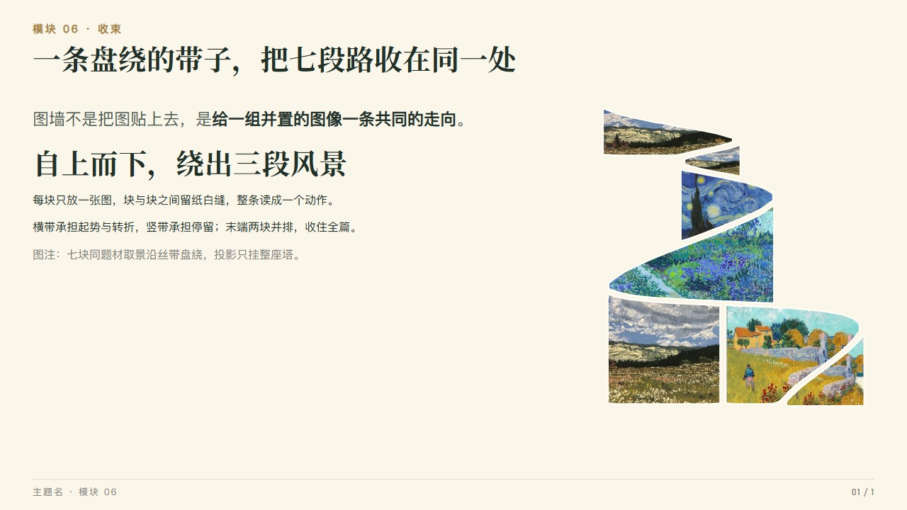
</p>

**06 半圆扇面式** — 多张图片围绕半圆展开，呈扇形放射状布局。

<p align="center">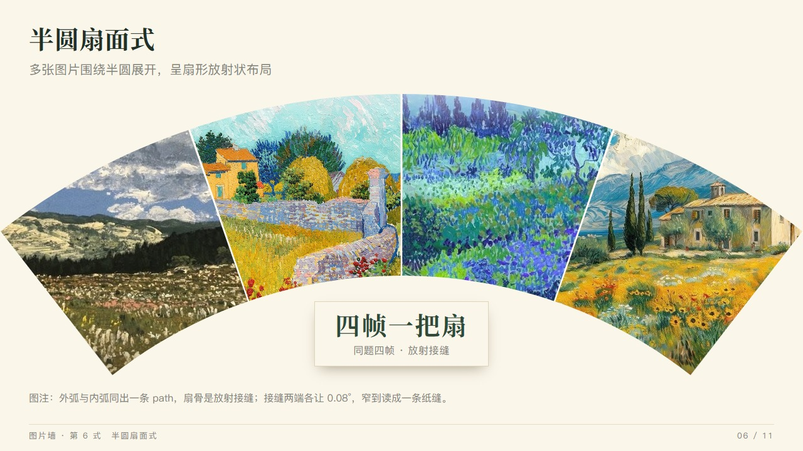</p>

**07 弧形切幅式** — 通过弧形裁切形成横向视觉延伸，突出图片主体。

<p align="center">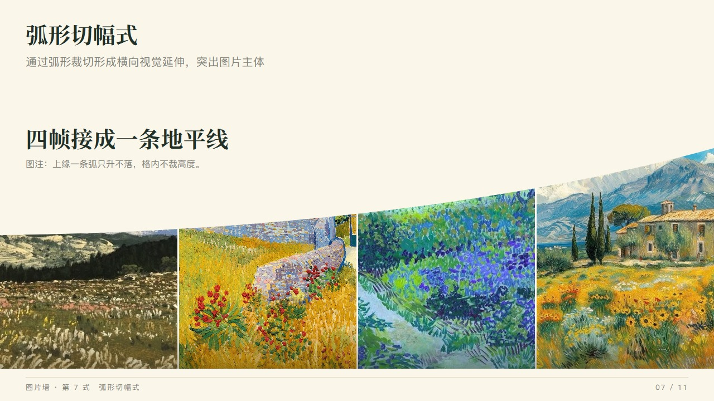</p>

**08 矩阵网格式** — 多张图片按照规则网格排列，整面卷成圆柱，强调整体性与秩序感。

<p align="center">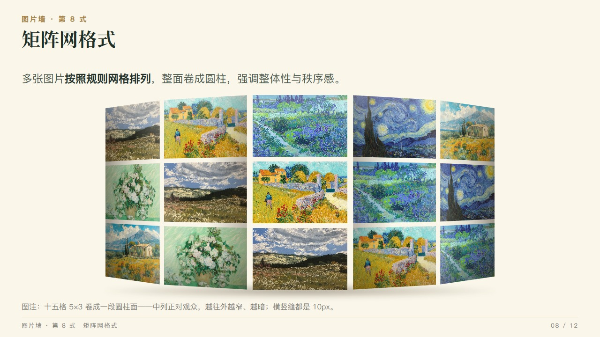</p>

**09 折页长卷式** — 图片以连续折页方式展开，形成空间层次与立体感。

<p align="center">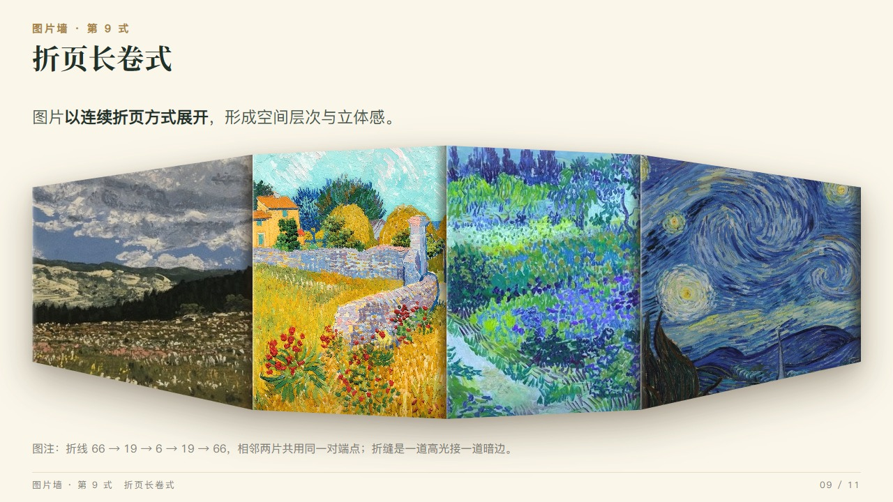</p>

**10 弧幕连屏式** — 多张竖幅图片沿弧线连续排列，形成环幕视觉效果。

<p align="center">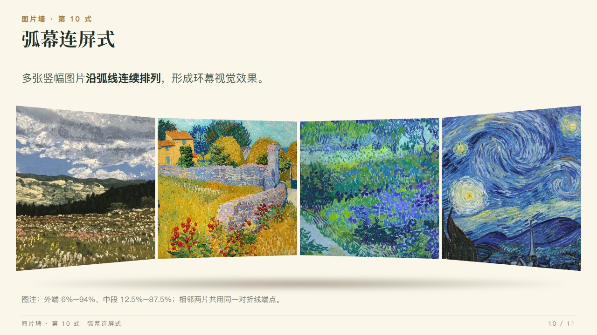</p>

**11 弧幕连屏式（内弧）** — 同一组图反向弯曲，中段鼓起、两端收进，视线被压回画面中央。

<p align="center">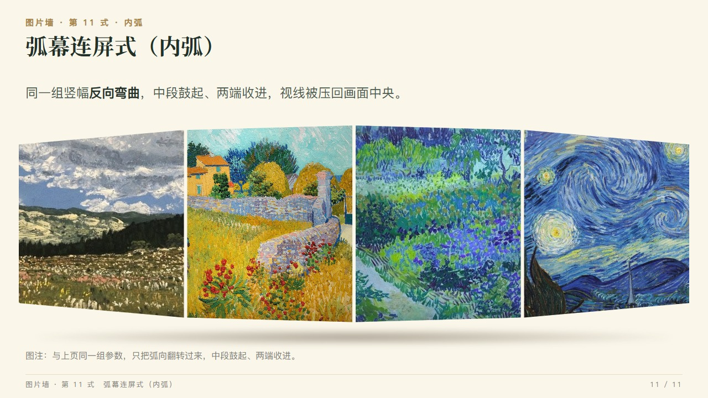</p>

**12 峰谷天际线式** — 多张竖幅底边对齐排成一行，高度对称起伏成峰谷，正中一扇深色主塔拔起压轴。

<p align="center">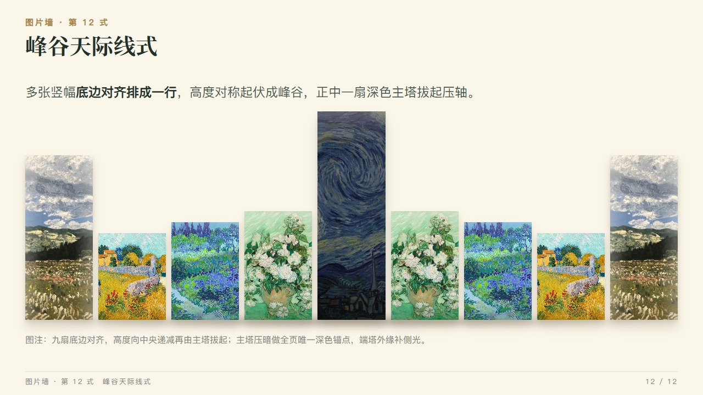</p>

**13 四季弧线式** — 图片沿弧形时间轴排列，适合表达季节、时间与变化。

<p align="center">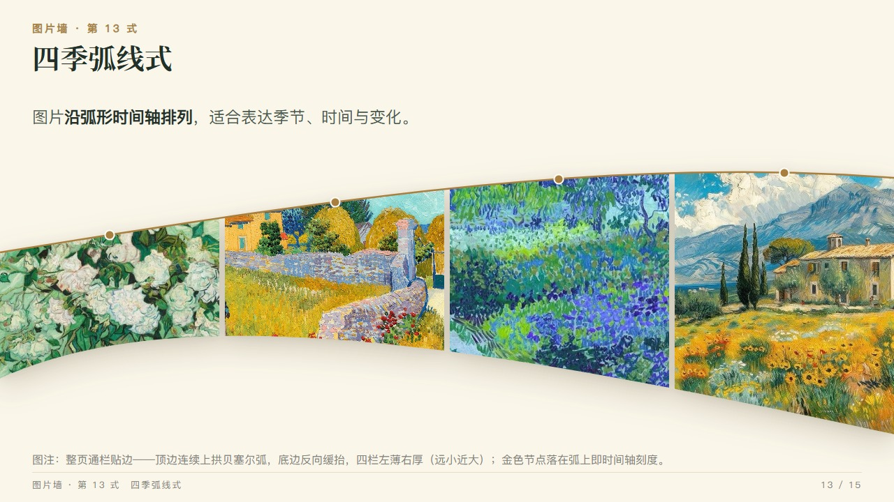</p>

**14 弧形内凹式** — 图片顶部与底部形成相反方向的弧形曲线，整体呈现中间收拢、两侧舒展的视觉效果，搭配多图分栏，营造柔和的空间层次。

<p align="center">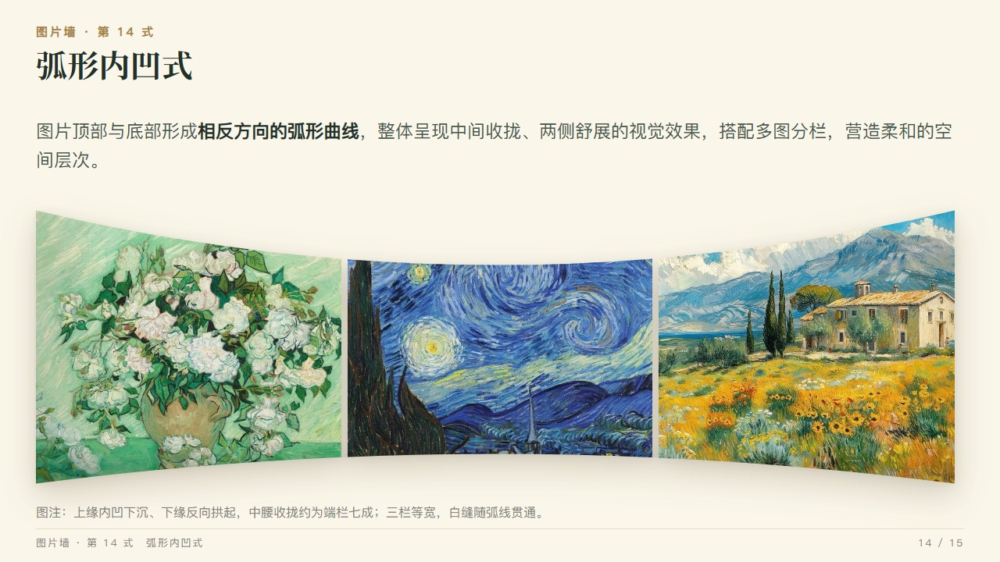</p>

**15 斜切折页式** — 左侧倾斜切口形成不规则几何形状，六张图片组成连续的立体折页，呈现从单一形态向完整画面展开的视觉效果。

<p align="center">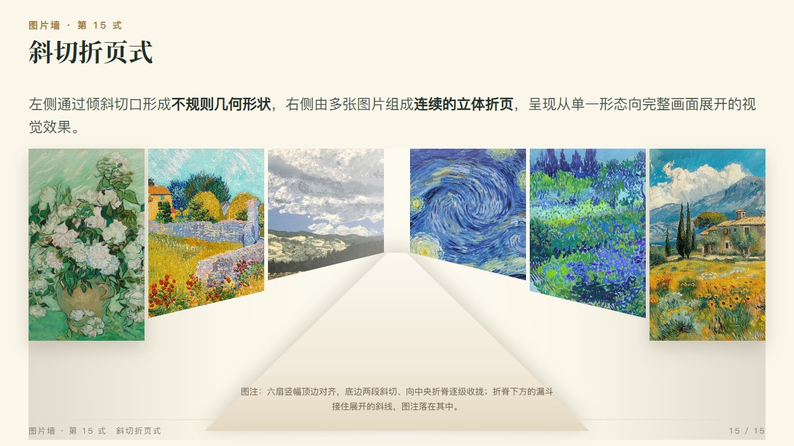</p>

| 式 | 形态 | 用于 | 图数 | 单格 | 横构图保留宽度 |
|---|---|---|---|---|---|
| **01 齐边错落式** | 多张独立排列，靠上下错位形成节奏 | 并列、等权、可比较 | 4–5 | 283×300 照片卡 | 67% |
| **02 波浪贯通式** | 沿连续波浪曲线拼接，形成整体画面 | 连续、推移、无断点 | 4 | 320×400，通栏大 S | 57% |
| **03 纵深渐进式** | 按纵向层次递进排列，营造空间纵深 | 层进、体系、过程归档 | 8 | 275×210，`rotateY(-25deg)` | 几乎不裁 |
| **04 不对称叶片式** | 以不对称弧形边缘连接，形成叶片效果 | 收束、汇总、收尾 | 4–5 | 318×420，一条遮罩 | 57% |
| **05 螺旋长卷式** | 七块沿一条带子盘绕，有起点与终点 | 行进、绕行 | 7 块（5–7 张图） | 最大 241×146、最小 87×53 | 竖格同 4，但最深的块只有 164 |
| **06 半圆扇面式** | 四片围绕半圆放射展开，扇骨即接缝 | 聚拢、围绕一个中心 | 4 | 扇片 320×449（径向厚 290） | ≈68%（扇片中段取景） |
| **07 弧形切幅式** | 只弯上缘，左低右高单向抬起 | 延伸、推移、地平线 | 4 | 竖片 320×440 | ≈48% |
| **08 矩阵网格式** | 5×3 十五格卷成一段圆柱面 | 秩序、整体、矩阵 | 15（5×3） | 202×132，居中 | 几乎不裁（格 3:2） |
| **09 折页长卷式** | 四片等宽梯形折成之字折屏 | 层次、展开、折页 | 4 | ≈348×404（等宽） | 51% |
| **10 弧幕连屏式** | 竖幅沿外弧连续排列，端片放大 | 环幕、连续、包围 | 4–5 | ≈320×404 | 51% |
| **11 弧幕连屏式（内弧）** | 同 10，弧向反转、中段鼓起 | 聚焦、收拢 | 4 | 同 10 | 51% |
| **12 峰谷天际线式** | 九扇底边对齐，高度对称起伏，主塔压暗压轴 | 压轴、锚点、收束 | 9（7–9） | 端塔 300 → 谷 158–198，主塔满高 380 | 几乎不裁（竖幅 1:1.4–2.7） |
| **13 四季弧线式** | 整页通栏贴边，整面贝塞尔弧：顶边连续上拱左低右高、底边反向缓抬，四栏左薄右厚（远小近大） | 时间、季节、行进 | 4 | ≈314×181–368（左薄右厚） | 裁切多（左右端各按弧收） |
| **14 弧形内凹式** | 上缘内凹下沉、下缘反向拱起，中腰收拢 | 柔和收放、层次、分栏 | 3（3–5 栏） | ≈387×350（端栏）/≈387×242（中栏） | 端栏几乎不裁，中栏上下各收约三成 |
| **15 斜切折页式** | 六扇竖幅顶边对齐，底边两段斜切向中央折脊收拢，中脊下漏斗托图注 | 展开、收拢、聚焦 | 6 | ≈185×310（六扇等宽，中脊 30px） | 竖幅优先（横图裁切约五成） |

- **横构图素材优先 3**（格子接近 3:2），1 次之；2 / 4 的竖格会裁掉约四成宽，更适合承担氛围。
  要保住整幅构图，就别进图墙，改照片卡或图文分栏。
- **6–11 式立体感的大头是光不是形变**：受光差、折缝一亮一暗、贴地椭圆影、外缘纸边；
  只转不压暗，转到 30° 也还是平板。共边折面（9 / 10 / 11）反着来——不用 `rotateY`，
  逐片旋转会让相邻两片的公共边错位 3–8px。
- 近大远小只认 `perspective` + `rotateY`；`skewX` 只是斜切，没有纵深。
- 立体感只靠四件事：暖白拼缝、沿轮廓 `drop-shadow`、边缘顶亮底暗、位置错落。不用发光与玻璃。
- 十五式的路径、参数与坑，见 `references/page-patterns.md` 第 12 节；
  6 式换张数 / 张角用 `scripts/fan-wall.py` 重算，别手改 path。

## 按图片个数选骨架 / Layouts by image count

十五式回答「这组图是什么关系」，个数回答「这一页有几张图」。选型顺序：先按关系定母题，
再按个数校验骨架；两边对不上时改图数（增删图、拆页），不硬缩图片。

| 个数 | 首选骨架 | 十五式对应 | 适合的内容主题 |
|---|---|---|---|
| 1 | 大图独占 + 条目块 / 底部通栏图 + 阶梯卡 | 封面、图文分栏 | 封面定调、核心观点、单一证据、里程碑 |
| 2 | 双图对分 + 两侧环绕 / 双图夹中央卡 + 步骤带 | 双案例对比页 | 对比、双支柱、主图＋细节 |
| 3 | 竖塔三叠 + 左右文字 / 花瓣扇轮 | 三栏 | 三阶段、三优势、流程节点 |
| 4 | 中央圆环四段弧图 / 四列卡 + 斜切图行 | 1 / 4 / 6 / 7 / 9 式 | 四象限、四季、四要点、团队 |
| 5 | 五张沿弧排开 + 图名 / 四分之一扇轮 | 1 / 4 / 10 式（.n5） | 五要素合集、核心＋四细分 |
| 6 | 环形六段图 / 蜂窝六边形 | 2×3 网格 | 六维模型、产品图集、多卖点 |
| 7 | 七张错落一行 / 半圆扇盘 01–07 | 5 螺旋长卷 / 12 峰谷 | 七步流程、多案例合集 |
| 8 | 两翼对称 + 中央内容卡 / 半圆扇盘八段 | 3 纵深渐进式 | 完整图集、历程＋成果 |
| 9 | 环形图簇 + 列表 + 胶片带 / 指标卡 + 弧形胶片带 | 12 峰谷 / 3×3 网格 | 年度成果、案例墙、时间胶片 |
| 10 | 顶部条目 + 2×5 斜切网格 / 导语 + 齐整网格 | 两行五列网格 | 全景回顾、十大亮点 |
| 11+ | 上下双弧形图带夹中央卡 / 指标卡 + 弧形胶片带 | 8 矩阵网格式 | 氛围墙、风采墙、相册集锦 |

每个骨架的文字配比、变体细节、米纸落地法与避坑，见 `references/image-count-layouts.md`。

## 目录结构 / Structure

```text
rice-paper-ppt/
├── SKILL.md                       # AI Skill 主文件（工作流、硬约束、版式选择表）
├── README.md                      # 本文件
├── LICENSE                        # MIT
├── manifest.json                  # 版本 / 归属 / 成熟度 / 产出契约
├── agents/
│   └── interface.yaml             # 跨平台接口声明（默认 prompt、激活与降级策略）
├── assets/
│   ├── theme.css                  # 版式系统：设计 token + 全部组件（714 行）
│   ├── deck.js                    # 缩放 / 翻页 / 全屏 / 打印 / 页码回填 / 视频控件（172 行）
│   ├── starter.html               # 6 页可运行骨架（文案已按规范改写）
│   ├── fx.js                      # 可选增强层：GSAP 编排 + WebGL/Canvas 注册接口
│   └── example.jpg                # 占位图
├── references/
│   ├── typography-spec.md         # 视觉层：排版与字号规范原文（11 节，验收标准）
│   ├── copywriting-spec.md        # 文案层·语言：标题 / 句式 / 术语口径 / 标点（8 节，验收标准）
│   ├── content-structure-spec.md # 文案层·结构：术语提炼 / 压缩 / 章节封面 / 可视化（12 节，验收标准）
│   ├── components.md              # 类名词典 + 可复制组件片段 + 硬坐标
│   ├── page-patterns.md           # 12 种版式配方 + 空旷 / 拥挤症状表
│   └── image-count-layouts.md     # 按图片个数选骨架：1–10 张与超多图速查 + 适配主题（含 img/ 参考图 11 张）
├── scripts/
│   ├── audit.js                   # 逐页版式审计（Node + Playwright）
│   └── contact-sheet.py           # 截图拼缩略图总览（Python + Pillow）
├── evals/
│   └── trigger_cases.json         # 路由用例（含触发与近邻负例）
└── examples/
    ├── preview.jpg                # 六页骨架预览
    ├── wall-stagger|wave|depth|fan.html  # 1–4 式示例页（一式一页，可运行）
    ├── wall-coil.html             # 5 式整页通栏示例页
    ├── wall-sec|crest.html        # 6–7 式示例页
    ├── wall-grid|fold|arc|arc-inner.html # 8–11 式示例页
    ├── wall-sky.html             # 12 式示例页
    ├── wall-tarc|conc.html       # 13–14 式示例页
    ├── wall-tilt.html            # 15 式示例页
    ├── wall-stagger|wave|depth|fan.jpg  # 1–4 式 1280×720 整页实拍（与同名 html 一一对应）
    ├── wall-coil.jpg              # 5 式整页通栏实拍
    ├── wall-sec|crest.jpg         # 6–7 式实拍
    ├── wall-grid|fold|arc|arc-inner.jpg # 8–11 式实拍
    ├── wall-sky.jpg              # 12 式实拍
    ├── wall-tarc|conc.jpg        # 13–14 式实拍
    ├── wall-tilt.jpg             # 15 式实拍
    └── img/                       # 示例素材（vg1–6 梵高六张，3:2 与 4:3 横构图为主）
```

## 快速开始 / Quick Start

### 1. 装进 Agent

```bash
cp -r rice-paper-ppt ~/.workbuddy/skills/     # WorkBuddy
cp -r rice-paper-ppt ~/.claude/skills/        # Claude Code
```

Agent 依据 `SKILL.md` 的 description 自动匹配触发词（「米纸风 PPT」「把这份 PPT 改成米纸风格」
「字放大一点、别那么空」等）。

### 2. 只用模板，不装 Skill

```bash
mkdir my-deck && cd my-deck
cp <repo>/rice-paper-ppt/assets/{theme.css,deck.js,starter.html} .
mv starter.html index.html
python -m http.server 8000        # 打开 http://localhost:8000
```

改 `index.html` 里的文案与图片即可。六个 `<section class="slide">` 分别演示一种版式。

### 3. 跑验收

```bash
npm i -D playwright-core && npx playwright install chromium   # 首次
node <repo>/rice-paper-ppt/scripts/audit.js http://localhost:8000/index.html ./shots
python <repo>/rice-paper-ppt/scripts/contact-sheet.py ./shots
```

输出示例：

```
页数 6｜硬问题页 0｜含微标签页 5
  仅小字号（人工判断是否为页码/图注）: P1,P2,P3,P4,P5
截图 → ./shots
```

有问题时逐条列出，例如 `P13  sb+42  out:DIV.card [b12]`，表示第 13 页内容区底部溢出 42px。
退出码：0 通过，1 有硬问题，2 环境未就绪。

已有 Chrome 时用 `CHROME_PATH=/path/to/chrome` 免下载浏览器；
`playwright-core` 装在非常规目录时用 `PW_CORE=/path/to/playwright-core`。

## 字号体系（1280×720 画布）

| 用途 | 变量 | 字号 |
|---|---|---:|
| 封面主标题 | `--fs-cover` | 76px |
| 章节标题 | `--fs-sec` | 60px |
| 页面主标题 | `--fs-h1` | 40px |
| 一级模块标题 | `--fs-h2` | 27px |
| 页面引导语 | `--fs-lead` | 23px |
| 卡片标题 | `--fs-card` | 23px |
| 正文 | `--fs-body` | 21px |
| 表格正文 | `--fs-td` | 20px |
| 表格表头 | `--fs-th` | 18px |
| 代码 | `--fs-code` | 18px |
| 注释 | `--fs-note` | 16px |
| 辅助标签 | `--fs-kick` | 15px |
| 页脚页码 | `--fs-foot` | 13px |

间距同理：`--pad-x` 46px、`--pad-t` 30px、`--gap` 16px；
内容区 `.sb` 从 y=150 到 y=662，**可用高度恒为 512px**，所有版式计算由这个数倒推。

## 配色 / Palette

| 变量 | 值 | 用途 |
|---|---|---|
| `--paper` | `#FAF6E9` | 页面底色（暖米纸） |
| `--paper-2` | `#F4EDDA` | 次级底 / 卡片 |
| `--green` | `#2F4A38` | 主色：标题、强调块、结语底 |
| `--gold` | `#A87F3F` | 辅助强调：编号、关键条 |
| `--ink` | `#22302A` | 正文墨色 |

换一套气质只改这三个主值即可，`--paper-2/3`、`--green-2` 等派生色会跟着变。

## 设计原则

内容优先级从高到低：**内容正确性 > 投影可读性 > 信息层级 > 空间利用率 > 视觉美观 > 装饰效果**。
文案分语言与结构两份，分别以 `references/copywriting-spec.md`（措辞/句式/标点）、
`references/content-structure-spec.md`（术语/层级/压缩/可视化）为验收标准，
视觉以 `references/typography-spec.md` 为验收标准；措辞冲突以前者为准、信息结构与术语命名以后者为准。
以准确传递信息为首要目标，以专业术语建立表达体系，以页面结构体现逻辑关系。

四条禁令（会掩盖问题，不是解决问题）：

1. 局部 `transform: scale()` 缩小内容
2. `zoom` 压缩页面
3. `overflow: hidden` 藏掉溢出的正文
4. 靠减小字号或滚动条承载放不下的内容

整页适配浏览器窗口的等比缩放是允许的，由 `deck.js` 统一处理。

## 兼容性

- Chromium / Chrome / Edge 现代版本；Firefox、Safari 亦可（渐变 `mask` 有轻微差异，不影响阅读）。
- 中文字体优先思源宋体 / 思源黑体 / 苹方 / 微软雅黑，缺失时回落到系统衬线 / 无衬线。
- 打印：`p` 键进入打印视图，每页一张 16:9；视频会显示首帧占位。

## 许可 / License

MIT，见 [LICENSE](LICENSE)。
