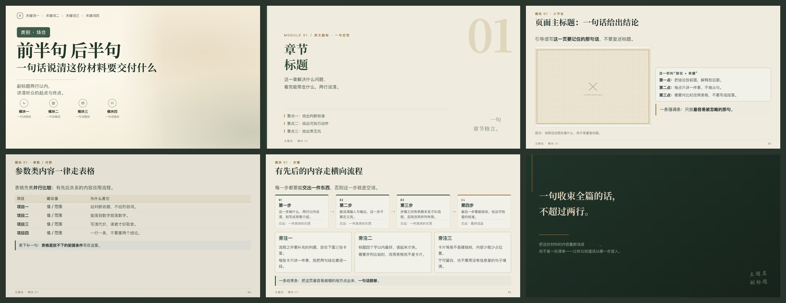

# 米纸质感 HTML 幻灯片

一套经 57 页真实幻灯片打磨的**视觉风格系统**，不是某种场合的专用模板。
核心设计目标一句话：

> **大而不乱，满而不挤，密而有序，重点突出。**

风格三要素：暖米纸底（`#FAF6E9`）、深林绿主色（`#2F4A38`）、哑光金辅助色（`#A87F3F`）；
中文用衬线大字做标题、无衬线做正文，配细发丝线与浅色卡片。
因为它按「大屏投影」定标，字号下限远高于普通网页，内容区覆盖率要求在 80%–90%——
**任何要在会议室、教室、展厅屏幕上讲的场合都适用**，不限行业与题材。

<p align="center">
  
</p>

## 何时使用

- 用户要做 HTML 幻灯片，并接受这套纸感中文排版（汇报、路演、方案、复盘、培训、分享、展陈均可）。
- 用户已有同类 `*.html` 幻灯片，要求「字放大」「别那么空」「排得专业点」「换成米纸风」。
- 用户明确要米纸底 + 墨绿 + 哑光金的学术 / 编辑质感，或要求沿用既有版式。

**不用**：交付物必须是可编辑 `.pptx`；或用户要的是科技风、玻璃拟态、霓虹发光那一路视觉。

## 安装

把本目录整体复制到 Agent 的技能目录即可：

```bash
# WorkBuddy
cp -r rice-paper-ppt ~/.workbuddy/skills/
# Claude Code
cp -r rice-paper-ppt ~/.claude/skills/
```

依赖只用于验收环节，写作本身零依赖：

| 依赖 | 用途 | 安装 |
|---|---|---|
| Node.js ≥ 18 | 运行 `scripts/audit.js` | 常规安装 |
| `playwright-core` + Chromium | 逐页真实渲染与截图 | `npm i -D playwright-core && npx playwright install chromium` |
| Python 3 + Pillow | 运行 `scripts/contact-sheet.py` 拼缩略图 | `pip install pillow` |

已有 Chrome/Chromium 时不必再下载浏览器，用 `CHROME_PATH` 指过去即可；
`playwright-core` 装在非常规位置时用 `PW_CORE` 指定模块路径。

## 交付物

一个 4 件套目录，**用户拿走整个目录双击 `index.html` 就能讲**（离线可用、无需构建）：

```
项目/
├── index.html        幻灯片本体（每页一个 <section class="slide">）
├── theme.css         版式系统（复制 assets/theme.css，只改 :root）
├── deck.js           适配缩放 / 翻页 / 全屏 / 打印（原样复制，不改逻辑）
└── assets/           图片、视频
```

`assets/starter.html` 是可直接运行的 6 页骨架，复制过来改文案即可，
**不要从空白 `<!DOCTYPE html>` 开始写**。

## 三条硬约束

1. **画布 1280×720，内容区可用高度恒为 512px**（`.sb` 从 y=150 到 y=662）。
   所有版式计算都从这个数出发：`lead` 37px、图注 46px、`.bar` 约 50px、gap 16px，先扣再分配。
2. **字号下限**：正文 20–24px；表格 / 代码 / 提示词 18–22px；图注 15–17px；页脚 13–15px。
   除页脚与装饰性微标签，不用 16px 以下的字。
3. **放不下就改结构，不许缩字号。** 禁止局部 `transform: scale()`、`zoom`、负边距、
   用 `overflow: hidden` 藏内容、用滚动条承载正文。整页适配窗口的等比缩放由 `deck.js` 统一处理，这个可以保留。

## 工作流

### 第 1 步：先定结构，再动手排版

把内容拆成「部分 → 页 → 每页的一句结论」，每页只承担一个作用，据此选版式：

| 页面作用 | 版式 | 配方 |
|---|---|---|
| 开场定调 | 封面 | 右视觉 + 左标题 + 4 个特性 |
| 分部分 | 章节分隔 | 超大编号 + 大标题 + 3 条要点 |
| 讲一个案例 | 图文分栏 | 图占 45–65%，文字只留 3 条结论 |
| 两案对照 | 双栏并列 | 等宽两列 + 一条 `.bar` 收束 |
| 比参数 / 比方案 | 表格 | 4–7 行；7 行以上用 `.tbl.tight` |
| 展示一段原文 | 引文框 | `pbox` + 结果图 + 高亮本次新增部分 |
| 讲步骤 | 横向流程 | 4 节点 + 旁注 + `.bar` |
| 名词解释 | 术语网格 | 4 列 × 4 行 |
| 讲代码 / 配置 | 代码页 | ≤14 行代码 + 3 条解释 |
| 收尾 | 结语 | 深绿底 + 一句结论，不超过两行 |

**相邻页不要用同一种版式。** 三页连排卡片网格，看起来就像模板没做完。

先输出这张结构表给用户确认，再动手写 HTML——返工成本主要来自结构而非样式。

### 第 2 步：复制骨架，改 token

```bash
cp <skill>/assets/theme.css <skill>/assets/deck.js <skill>/assets/starter.html <项目>/
mv <项目>/starter.html <项目>/index.html
```

`assets/example.jpg` 只是占位图，换成自己的素材后把 `src` 改到实际路径
（建议项目内建 `assets/` 放图）。

- `:root` 里的 `--fs-*` / `--gap-*` / `--pad-x` 是全局开关，**改这里，不要逐页写内联字号**。
- 需要更密的表格时用 `.tbl.tight` / `.tbl.xs`，不要动全局 `--fs-td`。
- 封面右侧默认渐变兜底；有配图时把图放进项目 `assets/`，在 `.cv-art` 里启用 `url()`。
- 想换配色体系时只改 `:root` 的 `--paper` / `--green` / `--gold`，其余颜色由它们派生
  （`--paper-2/3`、`--green-2` 等），组件不用动。

### 第 3 步：逐页填内容，每 3–5 页跑一次审计

```bash
cd <项目> && python -m http.server 8000            # 起本地服务
node <skill>/scripts/audit.js http://localhost:8000/index.html ./shots
python <skill>/scripts/contact-sheet.py ./shots     # 拼成缩略图总览
```

`audit.js` 逐页真实渲染（1280×720，deviceScaleFactor 1），输出五类问题，
并把每页截图存到 `./shots`：

| 检查 | 含义 |
|---|---|
| `sb+N` | 内容区底部溢出 N px —— 最常见，必须为 0 |
| `out` | 元素越出画布边界 |
| `clip` | 元素内部被 `overflow:hidden` 裁掉（代码块、卡片） |
| `spill` | 子元素超出容器 padding |
| `tiny` | <15px 的文本（页码 / 图注属正常，逐条判断） |

退出码：有硬问题返回 1，全部通过返回 0，可直接串进 CI 或脚本当闸门。
单页反复调时加 `--no-shots` 更快。

### 第 4 步：修，重跑，直到硬问题为 0

先扫缩略图总览定位可疑页，再单页放大看原图。常见修法见
`references/page-patterns.md` 末尾的症状表，高频三种：

- 内容区溢出 → 精简文案或拆页，**不要缩字号**。
- 图片两侧大面积留白 → 按原图比例改容器高度，或改栏宽比例。
- 下半页空 → 补一条 `.bar` 收束结论，或把上方主体放大。

### 第 5 步：交付前自检

逐页对照 `references/typography-spec.md` 第 10 节清单，并确认交互：
`← →` 翻页、`Home/End`、数字键跳页、`f` 全屏、`p` 打印、`#N` 深链、
视频播放与「开声音」按钮、非 1280 宽窗口下 `#deck` 等比缩放。

## 目录结构

```
rice-paper-ppt/
├── SKILL.md                       # 本文件：工作流与硬约束
├── README.md                      # 对外介绍（效果、结构、快速开始）
├── LICENSE                        # MIT
├── assets/
│   ├── theme.css                  # 版式系统（token + 全部组件）
│   ├── deck.js                    # 缩放 / 翻页 / 全屏 / 打印
│   ├── starter.html               # 6 页可运行骨架
│   └── example.jpg                # 占位图
├── references/
│   ├── typography-spec.md         # 排版与字号规范原文（验收标准）
│   ├── components.md              # 类名词典 + 可复制片段
│   └── page-patterns.md           # 十种版式配方 + 症状表
├── scripts/
│   ├── audit.js                   # 逐页版式审计
│   └── contact-sheet.py           # 截图拼缩略图
└── examples/
    └── preview.jpg                # 六页骨架预览
```

## 参考资料

| 文件 | 何时读 |
|---|---|
| `references/typography-spec.md` | 定字号、判断页面是否达标时——这是验收标准原文，冲突时以它为准 |
| `references/components.md` | 写页面前查类名、复制组件骨架时 |
| `references/page-patterns.md` | 选版式、判断「这页为什么空 / 挤」时 |
| `assets/starter.html` | 每次开工的起点 |
| `scripts/audit.js` · `scripts/contact-sheet.py` | 第 3–4 步的验收工具 |

## 容易犯的错

- **先写内容再想版式**：结果是每页都像文章，全是段落和卡片。
- **为等高而拉高卡片**：卡内只剩两行小字，视觉上就是「空」。
- **用 `cover` 放关键图**：主体被裁掉，观众看不到细节。关键图永远 `contain` + 浅色底。
- **引导语复述标题**：`lead` 要写「这一页要记住的那句」，不是把标题换个说法。
- **相邻页复制粘贴**：版式必须随内容变化，否则节奏会退化成翻页机器。
- **只改 CSS 不看渲染**：这个尺寸下 `overflow:hidden` 会静默吃掉内容，不截图就等于没验证。
- **用 `file://` 直接跑审计**：脚本读不到跨域资源，会出现假报错，务必先起本地服务。
