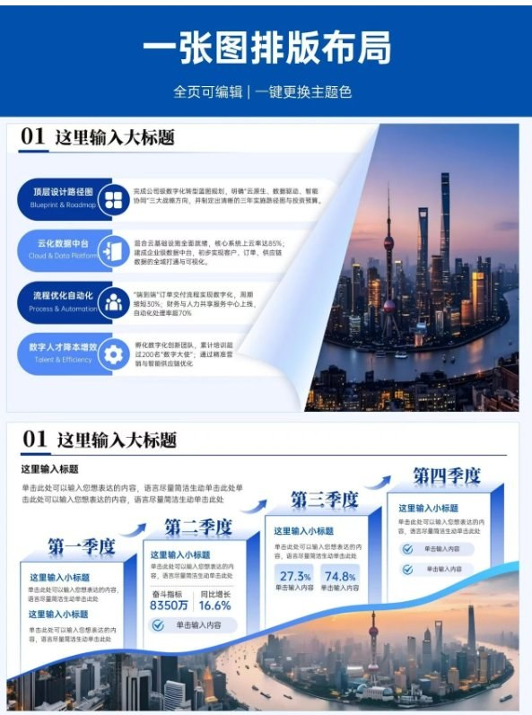
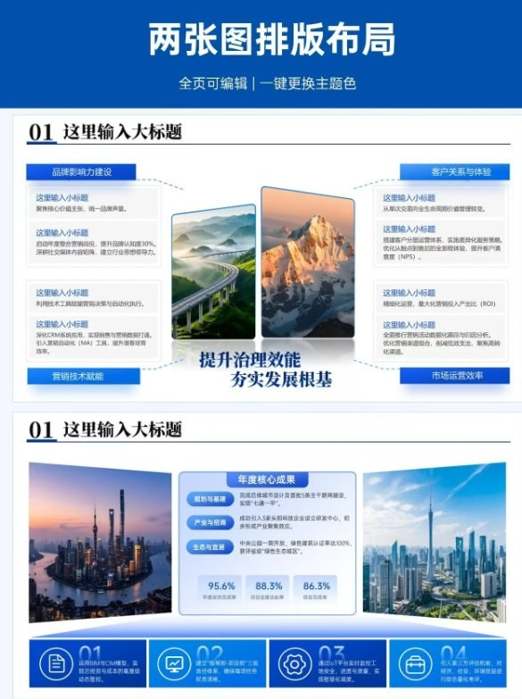
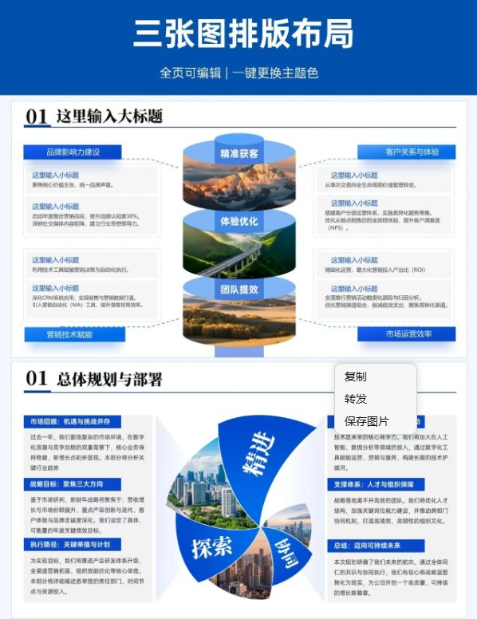
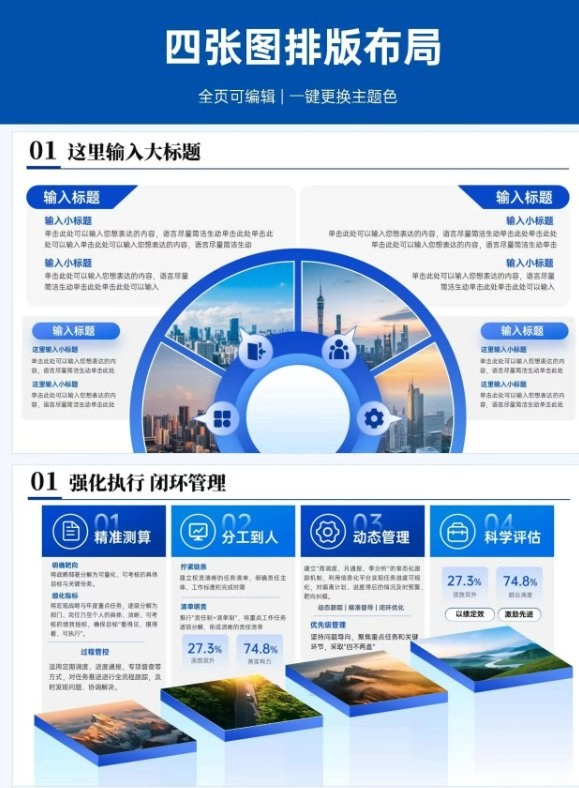
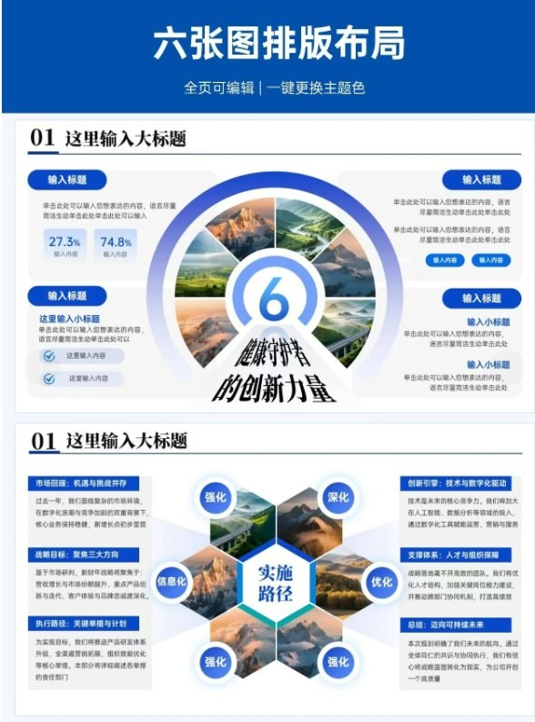
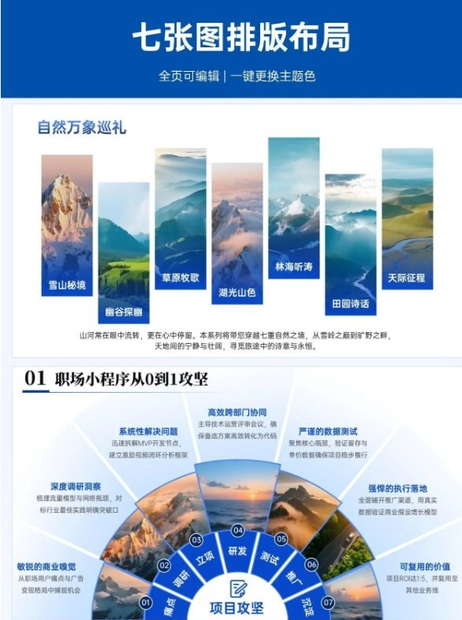
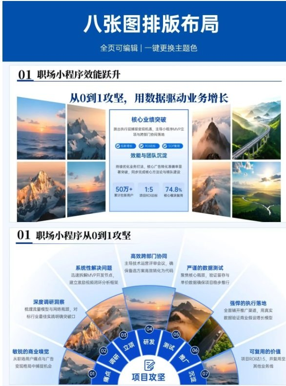

# 按图片个数选布局（个数规则）

一句话规则：**先数图，再选骨架——个数一变，结构就变。**

本表与图片墙十二式（`page-patterns.md` 第 12 节）分工：十二式回答「这组图是什么关系」
（并列 / 连续 / 层进 / 聚拢……），本表回答「这一页有几张图时，骨架长什么样」。
选型顺序：先用十二式按内容关系定母题，再用本表校验图数与骨架是否匹配；
两边对不上时，改的是图数（增删图、拆页），不是硬缩图片塞进不合适的骨架。

来源：2026-11-27 用户收集的 11 张按图数划分的排版参考（一图至十图、超多图各一张，
每张含两个变体），叠加外部调研（iSlide、二狗 PPT、雅客 PPT 的多图排版归纳）；
骨架描述已做风格中性化，落地一律回到米纸材质（拼缝、投影、顶亮底暗）。

## 速查表

| 个数 | 首选骨架（本表详解编号） | 十二式对应 | 适合的内容主题 |
|---|---|---|---|
| 1 | 大图独占 + 条目块（A）/ 底部通栏图 + 阶梯卡（B） | 不走图墙：封面、图文分栏 | 封面定调、核心观点、单一证据放大、里程碑 |
| 2 | 双图对分 + 两侧文字环绕（A）/ 双图夹中央卡 + 步骤带（B） | 不走图墙：双案例对比页 | 对比、双支柱、主图＋细节 |
| 3 | 竖塔三叠 + 左右文字（A）/ 花瓣扇轮（B） | 不走图墙：三栏 | 三阶段、三优势、流程节点 |
| 4 | 中央圆环四段弧图 + 四角文字（A）/ 四列卡 + 斜切图行（B） | 1 / 4 / 6 / 7 / 9 式 | 四象限、四季、四要点、团队 |
| 5 | 五张沿弧排开 + 图名（A）/ 四分之一扇轮（B） | 1 / 4 / 10 式（.n5） | 五要素合集、核心＋四细分 |
| 6 | 环形六段图 + 四角文字（A）/ 蜂窝六边形（B） | 2×3 网格 | 六维模型、产品图集、多卖点 |
| 7 | 七张错落一行（A）/ 半圆扇盘 01–07（B） | 5 螺旋长卷 / 12 峰谷 | 七步流程、多案例合集 |
| 8 | 两翼对称 + 中央内容卡（A）/ 半圆扇盘八段（B） | 3 纵深渐进式 | 完整图集、历程＋成果 |
| 9 | 环形图簇 + 列表 + 胶片带（A）/ 指标卡行 + 弧形胶片带（B） | 12 峰谷（9 扇）/ 3×3 网格 | 年度成果、案例墙、时间胶片 |
| 10 | 顶部条目 + 2×5 斜切网格（A）/ 导语 + 2×5 齐整网格（B） | 两行五列网格 | 全景回顾、十大亮点 |
| 11+（超多） | 上下双弧形图带夹中央卡（A）/ 指标卡 + 弧形胶片带（B） | 8 矩阵网格式（5×3） | 氛围墙、风采墙、相册集锦 |

## 参考图逐张对照表

11 张参考图（每张上下两个变体）原样内嵌如下，版式内容逐张存档，详解见下方「逐个数详解」：

| 参考图 | 变体一（上半页） | 变体二（下半页） |
|---|---|---|
| 1 张图  | 右侧一张大竖图（约 40% 宽通高），左侧标题 + 4 条纵向条目块（圆片图标 + 中英小标 + 两行说明），条目与图之间留空隙 | 底部通栏大图出血，上方标题 + 导语；中部 4 张季度阶梯卡（第一→第四季度逐级抬高，嵌数据）下缘融进大图 |
| 2 张图  | 两张竖图中置并排，左右各 3 条文字块环绕（带标签胶囊），中下方压一行大字结论 | 左右两张大图，中央夹一张内容卡（3 条胶囊要点 + 3 个数据）；底部一条 01–04 四步流程带 |
| 3 张图  | 竖塔三叠：三张图上下相接成一塔，各图上缘叠胶囊标签；左右各 3 条文字块环绕 | 花瓣扇轮：3–4 瓣各嵌一张图、瓣面叠大字（精进 / 探索 / 回归），左右各 3 条文字块 |
| 4 张图  | 中央圆环：环外缘四段弧各嵌一张图、环心放图标，四角各一组标题 + 文字对角呼应 | 01–04 四列编号卡片，每列下方一张斜切平行四边形图错位排成一行，卡内嵌数据 |
| 5 张图  | 五张竖幅沿一条上拱弧线排开（中间高两端低），每张底部叠图名；上方一行 3 个图标条目、下方一段总结 | 四分之一圆扇轮：5 瓣各嵌图、扇心叠大字 + 环绕小字；左侧标题 + 两段文字 + 3 个胶囊标签 + 底部数据条 |
| 6 张图  | 中央大圆环由 6 段图拼成整环，环心放编号 + 主题词；四角各一组标题 + 文字 | 蜂窝：中心一个六边形放主题词，周围 6 个六边形各嵌图 + 外圈关键词胶囊；左右各 3 条文字块 |
| 7 张图  | 七张竖图一行错落（高度不一、底边不齐，各叠图名）；左上角标题，下方一段总结 | 半圆扇盘：7 段编号 01–07 各嵌图（锚点 / 调研 / 立项 / 研发 / 测试 / 推广 / 沉淀），扇心放主题词，周围 7 条文字块放射环绕 |
| 8 张图  | 左右两翼各 3–4 张竖图错落、向中央收拢；中央一张内容卡（要点 + 数据行）压住翼图内缘，上方一行大字标题 | 同 7 图变体二的半圆扇盘，扇段扩到 8 |
| 9 张图  | 左侧环形图簇（6 段图成环、环心叠大字）；右侧条目列表 + 说明段 + 3 个图标条目；中部通栏横幅；底部胶片带嵌一排横图 | 一行 4 张指标卡（各带数据）；底部弧形胶片带嵌约 9 张小图 |
| 10 张图  | 顶部 4 条条目 + 2 张数据卡；下方 10 张图排成 2×5，整组作平行四边形斜切 | 标题 + 导语；下方 10 张图 2×5 齐整网格 |
| 超多图  | 上下两条弧形图带（各约 10–12 张小图沿弧排布）夹一张中央内容卡（要点 + 4 个胶囊标签）；顶部一行 4 个短词、底部一条结论横幅 | 一行 4 张指标卡；底部弧形胶片带嵌约 10 张小图 |

参考图里的共性手法，落地时可按米纸材质改造：**数据卡**（27.3% / 74.8% 一类大数字 + 小标签）压在图区之外承担说服、**胶囊标签**给每张图 2–6 字命名、**编号扇盘**（01–07）给流程序义、**阶梯卡**表达时间推进、**胶片带**表达时间序列、**环心 / 扇心大字**做环状构图的视线落点；这些焦点都是非图元素——印证通用规则第 6 条「图多配焦点」。

## 通用规则（所有个数共用）

1. **间距相等、裁齐不拉伸**：同组图统一裁成同一比例（宽度按高度反算），
   拉伸会让脸变宽、楼变矮；间距用等分布对齐，不逐个手拖。
2. **视觉重心对齐**：边框对齐了、图内主体歪着，整行仍然读歪；
   逐张在缩略图上确认 `object-position`，主体贴画幅边缘时直接推到底。
3. **图注留位**：多图页最容易漏的就是解释文字——没图注的图墙读不出编排意图；
   要点名某张时用与图注对应的 ①②③ 编号，不把标签压在图面上。
4. **对比同口径、序列同方向**：对比图必须同尺寸同角度（一张俯拍对一张仰拍没法比）；
   序列图方向一致（从左到右或从上到下，不混用）并加编号或时间标识。
5. **缩图自检**：整页缩到手机屏大小还能看出「这页在说什么」，骨架才成立；
   看不出来是骨架问题，不是图的问题。
6. **图少配大字、图多配焦点**：1–2 张时图就是主角，文字让位；
   9 张以上单张已不可读，必须给一个非图的焦点（内容卡 / 大字 / 数据条）承接视线。
7. **米纸落位**：所有骨架按内容区 512px 预算先扣再分配；一套 deck 图墙最多两次、
   形状不同、不与图文分栏页相邻（同十二式通用规则）；
   图墙区一律等宽白缝 + 沿轮廓投影，逐图配卡是模板感的来源。

## 逐个数详解

### 1 张图

- 骨架 A（大图独占 + 条目块）：右侧一张大竖图（约占 40% 宽、通高），左侧标题 +
  3–4 条纵向条目块（图标 + 小标题 + 两行说明），条目与图之间留呼吸空隙。
- 骨架 B（底部通栏图 + 阶梯卡）：底部一张通栏大图（约 1/3 高、出血到底），
  上方标题 + 导语，中间 3–4 级阶梯卡逐级抬高，卡片下缘融进大图。
- 文字：1 张图时图是唯一主角，条目 ≤ 4 条、每条两行以内。
- 适合：封面、核心观点页、单一成果 / 证据放大、时间推进（阶梯 = 里程碑）、氛围定调。
- 米纸落地：封面右视觉（`.cv-art`）与图文分栏（图占 45–65%）已覆盖骨架 A；
  骨架 B 的阶梯卡用 `.flow` 变体 + 底部通栏图实现，图仍遵守 `contain` + 浅色底
  （单张证据图不进图墙的 `cover` 例外）。
- 坑：单图不是图墙——图必须够大（≥45% 宽），缩成小卡再配四张卡片条目，
  读出来是「一张图 + 三张卡」两张皮。

### 2 张图

- 骨架 A（双图对分 + 环绕）：两张竖图中置并排，左右各 2–3 条文字块环绕，
  中下方压一行大字结论。
- 骨架 B（双图夹中央卡）：左右两张大图，中央夹一张内容卡（3 条胶囊 + 数据行），
  底部一条 01–04 步骤带收束。
- 文字：环绕块每条两行以内；骨架 B 里文字集中在中央卡，两翼不放长文。
- 适合：前后对比、两方案 A/B、双支柱、两地场景、主图 + 细节放大。
- 米纸落地：双案例对比页（`page-patterns.md` §4，`.g2` 等宽两列 + `.bar` 收束）。
- 坑：两张必须**同尺寸同比例同间距**——差一点「平等」的意思就没了；
  要表达主次就用一大一小，且至少三七开，五五开既不对称也不突出，最难看。

### 3 张图

- 骨架 A（竖塔三叠）：三张图上下相接成一个塔（各图上缘叠胶囊标签），
  左右各 3 条文字块环绕。
- 骨架 B（花瓣扇轮）：3–4 片花瓣扇轮各嵌一张图、瓣面叠大字，两侧配文字块。
- 文字：每张图一个胶囊标签（2–6 字）+ 两侧解释块。
- 适合：三阶段 / 三优势 / 三支柱、流程三节点、三项并列成果。
- 米纸落地：三栏等分（`.g3`）或竖塔（`.grow` 中列 + 左右文字列）；
  十二式不覆盖 3 张，不要硬塞进 4 张的式子。
- 坑：三栏并列要完全等分；一大两小就要主次明显（大图占一半以上），
  「差不多大」是最糟的状态。

### 4 张图

- 骨架 A（中央圆环 + 四角文字）：中央圆环外缘四段弧各嵌一张图，
  四角各一组标题 + 文字，对角呼应。
- 骨架 B（四列卡 + 斜切图行）：01–04 四列编号卡片，每列下方一张斜切图
  错位排成一行。
- 文字：四角或四列各承担一条要点，每条两行以内。
- 适合：四象限、四季 / 四季度、四要点、四产品、团队成员。
- 米纸落地：十二式里 4 张的选择最宽——1 齐边错落（并列比较）、
  6 半圆扇面（聚拢）、7 弧形切幅（延伸）、9 折页长卷（展开）。
- 坑：田字格最稳、一行四栏更紧凑，二选一看图的横竖构图；
  环形四段弧图在米纸风里用 6 式的放射接缝实现，别用竖直等宽缝拼圆环
  （圆心收拢处缝会张成锥形）。

### 5 张图

- 骨架 A（五张沿弧排开）：五张竖幅沿一条上拱弧线排开（中间高两端低），
  每张底部叠图名，上方一行图标条目、下方一段总结。
- 骨架 B（四分之一扇轮）：扇轮 5 瓣各嵌图、扇心叠大字，左侧标题 +
  两段文字 + 胶囊标签，底部数据条。
- 文字：图名压图（2–4 字），长解释放弧线外的总结段。
- 适合：五要素合集（五重奏 / 五感 / 五阶段）、核心 + 四细分的 1 大 4 小主次构图。
- 米纸落地：1 齐边错落（4–5 张）、4 不对称叶片（4–5 张）、10 弧幕连屏加 `.n5`。
- 坑：五张并列时单格仅约 253px 宽，人脸开始难辨——有人物的组图改 1 大 4 小，
  或减到四张；横构图裁切量见十二式「横图选式顺序」。

### 6 张图

- 骨架 A（环形六段图）：中央大圆环由 6 段图拼成整环，环心放编号 / 主题词，
  四角各一组文字。
- 骨架 B（蜂窝六边形）：中心一个六边形放主题词，周围 6 个六边形各嵌图 +
  外圈关键词胶囊，两侧配文字块。
- 文字：环心 / 蜂窝中心承担主标题，图内不压字。
- 适合：六维模型、产品图集、多维度卖点、成果展示。
- 米纸落地：2×3 或 3×2 网格最稳（先横后竖、方向统一）；
  十二式无 6 图式，环形骨架在米纸风里降级为网格 + 中心标题带，不做 3D 环。
- 坑：六张是最容易排成「六张一样大的贴纸」的数量——网格要有中心
  （标题带或中心卡），别六个格子围着空白转。

### 7 张图

- 骨架 A（七张错落一行）：七张竖图一行错落（高度不一、底边不齐），
  每张叠图名，上方标题、下方一段总结。
- 骨架 B（半圆扇盘）：下半页半圆盘 7 段编号 01–07 各嵌图、扇心放主题词，
  周围 7 条文字块放射环绕。
- 文字：骨架 B 的放射文字块每条两行以内，指向各扇段。
- 适合：七步流程、七种要素、多案例合集——奇数张天然适合错落与扇盘。
- 米纸落地：5 螺旋长卷式（7 块一条带子）讲行进；12 峰谷天际线式（7–9 扇）
  讲压轴收束。骨架 B 的扇盘米纸风用 6 式思路改造（编号扇段 + 放射文字）。
- 坑：奇数张别硬排两行（3+4 永远不齐）——错落、扇盘、峰谷都是打破呆板的正当手段；
  峰谷式必须奇数扇，主塔居中是前提。

### 8 张图

- 骨架 A（两翼对称 + 中央卡）：左右两翼各 3–4 张竖图错落、向中央收拢，
  中央一张内容卡（数据行 + 要点）压住翼图内缘。
- 骨架 B（半圆扇盘八段）：同 7 骨架 B，扇段扩到 8。
- 文字：文字集中在中央卡与卡上下，两翼逐图只配图名。
- 适合：完整图集、多品类展示、历程 + 成果混排。
- 米纸落地：3 纵深渐进式（8 张 4×2、右缘出血贴边）是十二式里唯一为 8 张定标的一式；
  骨架 A 的「两翼 + 中央卡」可直接用在 1 式错落的变形上（偶数列下移 + 中央卡跨压）。
- 坑：8 张时单张已小，逐图配长说明必挤——中央卡承担文字是骨架成立的前提；
  3 式角度超 30° 内容拉伸明显，参数见十二式。

### 9 张图

- 骨架 A（环形图簇 + 列表 + 胶片带）：左侧 6 段图拼成圆环、环心叠大字，
  右侧条目列表 + 图标行，底部一条通栏胶片带（横图一排）。
- 骨架 B（指标卡 + 弧形胶片带）：一行 4 张指标卡（数据 + 说明），
  底部弧形胶片带嵌 9 张小图。
- 文字：列表 / 指标卡承担解释，胶片带里的图不逐张配字。
- 适合：年度成果、案例墙、九宫格合集、时间胶片（按时间顺序的历程）。
- 米纸落地：12 峰谷天际线式（9 扇）讲压轴；普通 3×3 是九宫格模板感的重灾区，
  要么给一条通栏标题带破格，要么像骨架 B 一样拆出非图焦点；
  胶片带在米纸风里做成通栏横图排（`.g5` 两行网格或一行五张 + 白缝）。
- 坑：3×3 没有任何结构信息的九宫格 = 相册，不是论证；
  胶片带必须有时间或序语义才成立，纯装饰不如不放。

### 10 张图

- 骨架 A（顶部条目 + 斜切网格）：顶部 4 条条目 + 2 张数据卡，
  下方 10 张图排成 2×5，整组作平行四边形斜切。
- 骨架 B（导语 + 齐整网格）：标题 + 导语，下方 2×5 齐整网格。
- 文字：顶部条目每条两行以内；骨架 B 的导语压到两行。
- 适合：全景回顾、十大亮点、年度十件事、产品全集。
- 米纸落地：两行五列网格（单格约 236px 宽）；
  斜切在米纸风里只许整组 `skewX` 一次成型——它是装饰性倾斜不是纵深，
  别拿它冒充 3 式的透视。
- 坑：单格已缩到 236px，这页的图只能是同题材缩略性质；
  关键证据图别放进 10 图页，单独走图文分栏。

### 11 张以上（超多图）

- 骨架 A（双弧图带夹中央卡）：上下两条弧形图带（各 10–12 张小图沿弧排布）
  夹一张中央内容卡，顶部一行短词、底部一条结论横幅。
- 骨架 B（指标卡 + 弧形胶片带）：一行 4 张指标卡，底部弧形胶片带。
- 文字：中央卡 / 指标卡是唯一解释层；图带不配字。
- 适合：氛围墙、企业风采、相册集锦、全品类展示——图是纹理不是证据。
- 米纸落地：8 矩阵网格式（5×3 十五格卷成圆柱面）就是为超多图准备的；
  图不够相邻重复。更诚实的做法永远是拆页：`.tbl` 索引 + 两张代表图。
- 坑：超多图时单张已完全不可读，页面的信息由中央焦点承担、
  图只负责密度与氛围——没有中央焦点的超多图页在投影上就是一片噪点。

## 选型决策顺序

1. 数图：这一页到底几张？图数是硬约束，先落在速查表的行上。
2. 定关系：这组图是并列、连续还是聚拢？在行内按十二式挑母题。
3. 校验落位：出血 / 内容区 / 焦点卡是否都在 512px 预算内（十二式各式参数）。
4. 两边冲突：以内容关系为准，用增删图、拆页把图数挪回两表都覆盖的区间，
   不硬缩图片。
