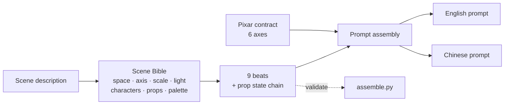

# Storyboard Sheet Prompt

**One paragraph of story in. One paste-ready prompt for a 16:9 hand-drawn storyboard sheet out.**


<!-- After you publish, enable the live CI badge:
[](https://github.com/<you>/storyboard-sheet-prompt/actions/workflows/ci.yml)
-->

An agent skill — plus a small zero-dependency CLI — that turns a scene description into a
production-grade image prompt for an animation pre-production storyboard page:

- **left two thirds** — exactly nine panels in a 3×3 grid, each in a thin wobbly red-ink frame, with handwritten shot numbers, framing labels and blue ballpoint arrow notes
- **right third** — a `CHARACTER DESIGN & CASTING` column: graphite sketch + finished Pixar-style 3D portrait + captions, plus a small villain/prop block
- **bottom strip** — three handwritten boxes: flow intent, camera notes, five-color palette

The layout is the easy part. Keeping **all nine panels inside the same room, the same light, the same palette** is what usually fails.

## What comes out

Two real sheets from this pipeline, one image per prompt, 1672 × 941, unretouched.

### A single-scene farce


Nine beats in one room, no dialogue. Layout, nine-beat rhythm, casting column and the three note boxes all
hold. The prop registry is where it slips: the cheese is one wedge in most panels and a whole wheel in 06.

### A two-hander with dialogue


Two characters, dialogue in the panels, a villain/prop block in the right column. This one also shows where
single-sheet generation is still weak: the nine panels drifted from graphite sketch toward finished 3D
render, and the note layer runs about 3× over the text budget — which is why a couple of handwritten labels
already read as scribbles.

Both sheets are here as evidence, not as a finished demo. See [Known limits](#known-limits).

---

## The problem

Write nine panels one at a time and the model re-imagines the world nine times. Panel 01 decides the seed bowl is white ceramic; panel 07 makes it stainless steel. The shavings are warm yellow in panel 03 and pink in panel 09. The hamster has a tiny scarf in panel 04 and loses it in panel 05.

That is not the model being dumb. It is you never giving it an **immutable reference**.

| | Without a Bible | With a Bible |
| --- | --- | --- |
| Same prop across panels | drifts in color, shape or name | one canonical descriptor, reused verbatim |
| Light | changes with the mood of the prompt | one direction, frozen for the whole sheet |
| Screen axis | mirrors somewhere around panel 05 | declared once, never flipped |
| Scale | "a huge kitchen" becomes an ordinary kitchen | `counter 90 cm / hamster 15 cm ≈ 6:1` |
| Prop continuity | bag reappears after it was emptied | state enum, legal transitions only |

## What makes this different from a prompt template

1. **Scene Bible before any panel wording.** Space, screen axis, scale, light, prop registry with state enums, character locks, palette. Nine panels are nine windows into one world, not nine illustrations.
2. **Verbatim reuse is a hard rule.** The same prop cannot be called `seed bowl` in panel 01 and `nut bowl` in panel 07 — the model treats those as two objects.
3. **Props move through a state chain.** `upright_on_shelf → tipping → burst_open → flattened_on_floor`. Anything outside the enum is a validation error.
4. **Pixar is a contract, not a style word.** Six axes with numbers (silhouette test, head-to-body ratio, eye-to-face ratio, roughness ranges, one-sided rim, lifted blacks). "In the style of Pixar" alone produces the plastic-glossy fake.
5. **A validator that refuses to render.** Unregistered prop, out-of-enum state, Chinese dialogue in an English line, eight panels — it exits non-zero and tells you which panel.

## Install

### As an agent skill

```bash
git clone https://github.com/<your-account>/storyboard-sheet-prompt.git \
  ~/.workbuddy/skills/storyboard-sheet-prompt
```

For Claude Code or other agents that read a skills directory, clone into that directory instead
(e.g. `~/.claude/skills/storyboard-sheet-prompt`). The repository root **is** the skill package —
`SKILL.md` sits at the top, nothing to build.

### As a CLI

```bash
git clone https://github.com/<your-account>/storyboard-sheet-prompt.git
cd storyboard-sheet-prompt
python -m pip install -e .
```

No runtime dependencies. Python 3.9+.

## Use

### Just describe the scene

With the skill installed, say what happens:

> 阿坚是只坚信自己是特工的仓鼠，豆豆是它被迫当技术支援的豚鼠。厨房里，阿坚想拿到吊柜上的坚果袋，失败了三次，最后发现主人给它准备了生日蛋糕。做成分镜。

You get back two paste-ready prompts — English first, Chinese second — plus a few lines telling you
what was inferred on your behalf. No files, no JSON, no ledger.

### With a board file

When the setup needs to be reused, a panel needs a rerun, or nine panels span several sessions:

```bash
storyboard-sheet board.json --stdout        # print, write nothing
storyboard-sheet board.json                 # write ./prompt.md (both languages)
storyboard-sheet board.json --en-only       # English only
storyboard-sheet board.json --check-only    # validate only
storyboard-sheet board.json -o out/ --full  # split package: per-language + ledger + per-cell
```

Or without installing:

```bash
python scripts/assemble.py examples/nut-crisis.json --stdout
```

Board format: [`references/board-schema.md`](references/board-schema.md).
Worked example: [`examples/nut-crisis.json`](examples/nut-crisis.json).

## How it works



Three layers:

| Layer | Job | Lives in |
| --- | --- | --- |
| Bible | decide what this world contains, once | `references/scene-bible.md`, internal |
| Beats | nine panels, each a state transition | `SKILL.md` Step 2 |
| Assembly | one prompt, all constants injected verbatim | `references/prompt-templates.md`, `scripts/assemble.py` |

The Bible is a **process artifact**. It survives as the `SETTING` / `CHARACTERS` / `PROPS` / `PALETTE`
blocks inside the prompt — not as a separate deliverable.

## The Scene Bible, concretely

```json
{
  "world": {
    "axis_en": "screen-left = cage and shavings, screen-right = countertop and the tall cabinet; never mirrored",
    "scale_en": "countertop 90 cm, hamster 15 cm, guinea pig 25 cm — roughly 6:1",
    "light_en": "single warm window key from frame-left 45°, cool grey fill from frame-right, no overhead"
  },
  "props": [
    {
      "id": "nut_bag",
      "name_en": "the burlap nut bag",
      "lock_en": "a small burlap nut bag, warm mid-brown #8A5A2B, one frayed corner",
      "states": ["upright_on_shelf", "tipping", "burst_open", "flattened_on_floor"]
    }
  ]
}
```

Everything downstream cites these strings. `#8A5A2B` is written once and appears in every prompt that
needs it; the renderer never gets a chance to pick its own brown.

## Consistency rules

| # | Rule | What breaks without it |
| --- | --- | --- |
| 1 | One source: colors, props, shapes come from the Bible only | improvising on the spot always drifts |
| 2 | Prop registry: one English name per object | synonyms become two objects |
| 3 | State chain closed, legal transitions only | feels like dropped frames |
| 4 | Color budget: palette + graphite grey + red ink + blue ink | a fifth hue is a failure |
| 5 | Three anchors per character, every panel, same words | audience stops recognizing them |
| 6 | Light frozen; reverses must be declared | changing light = changing spacetime |
| 7 | Screen axis frozen; nine panels never mirror | one flip and the sheet falls apart |
| 8 | Scale anchors in numbers | "huge" renders as ordinary |
| 9 | Second appearances say `same … as panel 01` | re-describing always drifts |
| 10 | Exactly nine panels, no tenth, no blank | layout collapses |
| 11 | No three consecutive panels share a framing | the page goes flat |
| 12 | Minimal text: shot number + 2–4 word labels | long lines turn into scribbles |
| 13 | Style anchors written out every time | the plastic fake-Pixar look |

## Pixar render contract

Pixar's own position: realism was never the goal — that is why it reads as *stylized* realism.
Adding the five words "in the style of Pixar" degrades into round face + big eyes + plastic
specular, which is exactly what AI-looking 3D looks like.

| Axis | Numeric requirement |
| --- | --- |
| Form | silhouette readable when filled black at thumbnail size; **one** dominant shape per character; juvenile head-to-body 1:2–1:3; eye height ≈ 1/3 of face height, set low; features reduced; one deliberate imperfection kept |
| Material | subsurface scattering only at fur edge / ear / nose / cheek; fur roughness 0.35–0.55, cloth 0.6–0.8; hand-authored texture; secondary objects lose detail; **no plastic or wax specular** |
| Light | one key direction, area lights; rim light on **one side only**; shadows tinted toward sky color; physically impossible fill allowed; no golden-hour-everywhere |
| Color | one color relationship per scene; saturation from value separation and warm/cool contrast, not hue count; blacks lifted, highlights rolled off; one brightest focal point |
| Space | atmospheric perspective; scale may be exaggerated but weight and contact shadows must be correct; ~35 mm, low angle, shallow depth of field; no dead-center symmetry |
| Performance | expressions pushed 15–20% to the edge of breaking shape; catchlight in the eye obeying the key; one emotion per shot |

**Layered application** — the sheet is not a 3D render. The paper stays white with wobbly red frames
and graphite sketches; the *world inside each frame* reads as a Pixar film; the two 3D portraits in the
right column are the only finished renders.

## Voice: contrast is a delta, not an adjective

Writing "a funny squeaky voice and a lazy slow one" gives you two cute voices and no tension.

| Axis | Driver | Commentator |
| --- | --- | --- |
| Pitch center | high, narrow, rising | low, flat, near-monotone |
| Tempo | 4.5–5.5 syllables/s | 2.5–3 syllables/s |
| Sentence | short commands, self-codenamed | 3–6 words, trailing off |
| Breath | sharp inhale before every line | long exhale, chewing texture |
| Mix | close mic, dry, +2 dB | 1.5 m back, small-room reverb, never louder |

Dialogue is English only, ≤ 2 lines per panel, ≤ 8 words per line. The reverse test: *if the line can be
reassigned to the other character, there is no contrast — rewrite it.*

## Output strategy

| | What | When |
| --- | --- | --- |
| A | single full sheet, one image | proposals, mood. Needs 4K+; below that the panels mush together |
| B | panels / right column / footer generated separately, composited | when the text must actually be readable |
| C | full sheet + 2–3 enlarged key panels | client review |

Default is A. The other two exist because nine panels plus a casting column plus three note boxes is a
lot to ask of one image — see [Known limits](#known-limits).

## Repository layout

```
.
├── SKILL.md                      the skill contract: delivery rules, 4 premises, 4 steps, 13 red lines
├── agents/interface.yaml         portable activation / execution / trust metadata
├── manifest.json                 version, maturity, known limits
├── references/
│   ├── scene-bible.md            Bible fields, state chains, anti-drift rules
│   ├── pixar-style.md            six-axis render contract, paste-ready blocks, sources
│   ├── sheet-layout.md           page proportions, nine-beat rhythm, failure modes
│   ├── prompt-templates.md       four paste-ready templates
│   ├── voice-casting.md          four-axis contrast, English dialogue standards
│   ├── board-schema.md           JSON input format
│   └── delivery-checklist.md     pre-delivery checklist
├── scripts/assemble.py           board.json → prompt(s) + validator
├── examples/
│   ├── nut-crisis.json           worked board
│   ├── out/prompt.md             default output (English + Chinese)
│   ├── full/                     --full split package
│   └── renders/                  two real sheets, unretouched
├── tests/test_assemble.py        16 tests, stdlib only
└── evals/cases.md                routing / behaviour / consistency scenarios
```

## Known limits

- **Panel density.** Nine 16:9 panels + a casting column + three note boxes in one 16:9 page is close to
  what current models can hold. Below ~4K the handwritten labels degrade first. The two sheets above are
  real renders, but two is anecdote, not a benchmark — see [Contributing](#contributing) if you want to
  help close that gap.
- **The validator checks structure, not sense.** It will not notice that a panel's prop state contradicts
  the story. A human still reads every sheet.
- **Handwritten text is the first thing to break.** Anything beyond a shot number and 2–4 word labels
  risks coming out as scribble.
- **Voice blocks are for TTS / casting.** A still image cannot verify them.

## Contributing

Issues and PRs welcome. Most useful contributions right now:

1. **Real render comparisons** — A vs B output quality at 2K / 4K, so the density limit becomes measured
   instead of assumed.
2. **More Bible examples** — ensemble casts, multi-location scenes, night scenes. The Bible granularity
   table in `SKILL.md` is thin on those.
3. **Rhythm presets** — farce / suspense / warm, as three selectable nine-beat templates.

Before opening a PR:

```bash
python -m unittest discover -s tests -v
python scripts/assemble.py examples/nut-crisis.json --stdout > /dev/null
```

If you change the validator, add a test that proves the new rule rejects the bad input. The validation
tests are the point of the script.

## License

MIT — see [LICENSE](LICENSE).

The Pixar-style specifications in `references/pixar-style.md` are craft observations with cited sources,
not Pixar material. No affiliation with Pixar Animation Studios or Disney.
