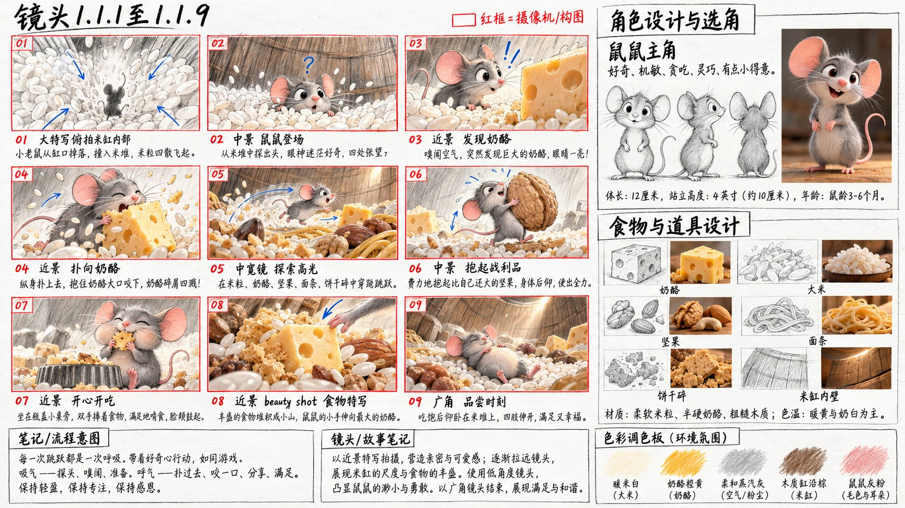
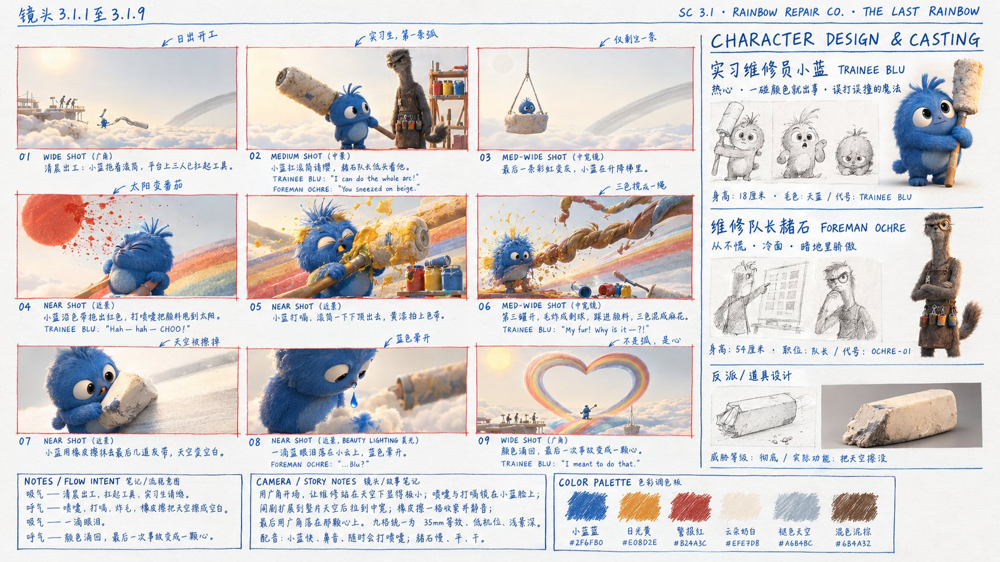

# 手绘分镜脚本提示词

**一段故事情景进去，一张可直接粘贴的 16:9 手绘分镜脚本页提示词出来。**


[English](README.md) · 简体中文

一个 Agent Skill，外加一个零依赖的小命令行工具。把口述的情景变成动画电影前期分镜脚本页的出图提示词：

- **左侧三分之二**——严格 9 格 3×3 网格，每格细红线手绘框，手写镜号、镜别标注、蓝色圆珠笔箭头注释
- **右侧三分之一**——`角色设计与选角`竖栏：铅笔素描 + 皮克斯风 3D 肖像 + 图注，下方接反派/道具小栏
- **页脚**——三个手写方框：流程意图、镜头笔记、五色调色板

版式是最容易的部分。真正容易出事的是**让九格待在同一个房间、同一束光、同一套颜色里**。

## 出来长什么样

两张真实出图，每个提示词一张，1672 × 941，未修图。

### 单场景闹剧



一个房间九拍，无对白。版式、九拍节奏、角色栏、三个页脚框全部成立。失守的是道具注册表——奶酪在多数格里是楔形，第 06 格变成整只圆轮。

### 双人对白



两个角色、格内有对白、右栏带反派/道具小卡。这一张也暴露了单张整页生成目前的短板：九格从石墨速写漂成了完成度很高的 3D 渲染，注释文字量超预算约 3 倍——有几处手写标签已经开始糊了。

两张摆在这里是当证据，不是当成品展示。见下方「已知限制」。

---

## 它解决什么

一格一格写提示词，模型会把这个世界重新想象九遍。第 01 格决定食盆是白瓷的，第 07 格变成不锈钢；木屑第 03 格是暖黄，第 09 格变粉；仓鼠第 04 格多了条小围巾，第 05 格又没了。

不是模型笨，是你没给它一个**不可变的引用**。

| | 没有资产锁定表 | 有资产锁定表 |
| --- | --- | --- |
| 同一道具跨格 | 颜色、形状、叫法全漂 | 一个规范描述串，逐字复用 |
| 光 | 随提示词情绪变 | 一个方向，整页冻结 |
| 视轴 | 第 5 格附近镜像了 | 声明一次，永不翻转 |
| 比例 | "巨大的厨房"被画成普通厨房 | `台面 90cm / 仓鼠 15cm ≈ 6:1` |
| 道具连续性 | 袋子空了又满回来 | 状态枚举，只走合法转移 |

## 与「提示词模板」的区别

1. **先建 Bible，再写格子。** 空间、视轴、比例、光位、道具注册表（带状态枚举）、角色造型锁、色板。九格是同一世界的九个窗口，不是九张插画。
2. **逐字复用是硬规则。** 同一个道具不能第 01 格叫 `seed bowl`、第 07 格叫 `nut bowl`——模型会当成两个东西。
3. **道具走状态链。** `upright_on_shelf → tipping → burst_open → flattened_on_floor`。枚举外的值直接报错。
4. **皮克斯是契约，不是风格词。** 六轴都给数字：剪影测试、头身比、眼脸比、粗糙度区间、单侧轮廓光、暗部不死黑。只写 "in the style of Pixar"，出来的是最像 AI 的塑料假 3D。
5. **校验器会拒绝渲染。** 道具未注册、状态越界、英文对白里混中文、只有 8 格——直接非零退出，并告诉你第几格。

## 安装

### 作为 Agent Skill

```bash
git clone https://github.com/<你的账号>/storyboard-sheet-prompt.git \
  ~/.workbuddy/skills/storyboard-sheet-prompt
```

Claude Code 等读 skills 目录的 Agent，clone 到对应目录即可（如 `~/.claude/skills/`）。仓库根**就是**技能包，`SKILL.md` 在顶层，不需要构建。

### 作为命令行工具

```bash
git clone https://github.com/<你的账号>/storyboard-sheet-prompt.git
cd storyboard-sheet-prompt
python -m pip install -e .
```

无运行时依赖，Python 3.9+。

## 使用

### 直接说情景

装好技能后，把情景丢过来：

> 阿坚是只坚信自己是特工的仓鼠，豆豆是它被迫当技术支援的豚鼠。厨房里，阿坚想拿到吊柜上的坚果袋，失败了三次，最后发现主人给它准备了生日蛋糕。做成分镜。

拿回两段可直接粘贴的提示词——英文在前、中文在后——外加几行说明"我替你补了什么"。不落文件、不产 JSON、不给台账。

### 用 board 文件

需要复用同一套设定、要逐格返工、或九格跨多轮做时：

```bash
storyboard-sheet board.json --stdout        # 打印，不落盘
storyboard-sheet board.json                 # 写 ./prompt.md（中英两段）
storyboard-sheet board.json --en-only       # 只要英文段
storyboard-sheet board.json --check-only    # 只校验
storyboard-sheet board.json -o out/ --full  # 拆分包：分语言 + 台账 + 单格稿
```

不安装也可以：

```bash
python scripts/assemble.py examples/nut-crisis.json --stdout
```

字段说明见 [`references/board-schema.md`](references/board-schema.md)，可跑范例见 [`examples/nut-crisis.json`](examples/nut-crisis.json)。

## 三层结构

| 层 | 干什么 | 在哪 |
| --- | --- | --- |
| Bible | 一次性决定这个世界有什么 | `references/scene-bible.md`，内部过程 |
| Beats | 九拍，每拍一次状态转移 | `SKILL.md` Step 2 |
| 拼装 | 一份提示词，所有常量逐字注入 | `references/prompt-templates.md`、`scripts/assemble.py` |

Bible 是**过程产物**。它的最终形态是提示词里的 `SETTING` / `CHARACTERS` / `PROPS` / `PALETTE` 段落，不单独成文。

## 资产锁定表长什么样

```json
{
  "world": {
    "axis_en": "screen-left = cage and shavings, screen-right = countertop and the tall cabinet; never mirrored",
    "scale_en": "countertop 90 cm, hamster 15 cm, guinea pig 25 cm — roughly 6:1",
    "light_en": "single warm window key from frame-left 45°, cool grey fill from frame-right, no overhead"
  },
  "props": [
    {
      "id": "nut_bag",
      "name_en": "the burlap nut bag",
      "lock_en": "a small burlap nut bag, warm mid-brown #8A5A2B, one frayed corner",
      "states": ["upright_on_shelf", "tipping", "burst_open", "flattened_on_floor"]
    }
  ]
}
```

下游全部引用这些字符串。`#8A5A2B` 只写一次，需要它的每一格都拿到同一个值，渲染器没有机会自己挑一个棕色。

## 一致性红线

| # | 规则 | 违反的后果 |
| --- | --- | --- |
| 1 | 单一来源：颜色/道具/外形只从 Bible 取 | 现场造句必走形 |
| 2 | 道具注册制：一个物件一个英文名 | 同义词 = 两个东西 |
| 3 | 状态链闭合，只走枚举内转移 | 跳帧感 |
| 4 | 色彩预算：色板 + 石墨灰 + 红框 + 蓝箭头 | 第五种彩色就是失败 |
| 5 | 角色三锚每格在，用同一串词 | 观众认不出是同一只 |
| 6 | 光位写死，反打要显式声明 | 改光 = 换时空 |
| 7 | 视轴写死，九格不许镜像 | 翻一次整页就散 |
| 8 | 比例锚数字化 | "巨大"会被画成普通 |
| 9 | 二次出现写 `same … as panel 01` | 重描述必漂 |
| 10 | 格数锁死 9 | 版式崩塌 |
| 11 | 同镜别不连续 3 格 | 节奏死 |
| 12 | 文字最小化 | 长句必成乱码 |
| 13 | 风格锚每单原样粘贴 | 出来的是塑料假 3D |

## 皮克斯渲染契约

皮克斯自己的立场是"写实从来不是目标"——所以它读起来是**风格化写实**。造型往外推、材质往里收、光被人为编排，三样同时对才像。

| 轴 | 硬指标 |
| --- | --- |
| 造型 | 填黑缩到拇指大仍可辨；每角色一种主动力形状；幼态头身比 1:2–1:3；眼高约占脸高 1/3 且偏低；五官做减法；留一处刻意的不完美 |
| 材质 | 次表面散射只给毛边/耳/鼻/颊；毛粗糙度 0.35–0.55，布 0.6–0.8；手绘感纹理；次要物件降细节；禁止塑料蜡感高光 |
| 光 | 单一主光方向，面积光为主；轮廓光只打一侧；阴影可带天光色；允许违反物理补光；禁止处处黄金时刻 |
| 色 | 一段落一组色彩关系；高饱和靠明度分层与冷暖对比；暗部不死黑、高光不切白；一格一个最亮焦点 |
| 空间 | 大气透视化开远景；尺度可夸张但重力与接触阴影必须对；35mm 上下、低机位、浅景深；不许正中对称 |
| 表演 | 表情夸张 15–20% 到破形为止；眼睛 catchlight 服从主光；一个镜头只演一个情绪 |

**分层落法**：纸面仍是白纸 + 细抖红框 + 石墨速写；每格框内的**世界**读作皮克斯电影；右栏两张 3D 肖像是全页唯一的完成品。别把整页做成 3D。

## 语音反差

写"一个活泼搞笑、一个慵懒缓慢"只会得到两个都挺可爱。反差来自四条可量化轴的差值：

| 轴 | 主导者 | 吐槽者 |
| --- | --- | --- |
| 音高中心 | 高、窄、上扬 | 中低、平、几乎单音 |
| 语速 | 4.5–5.5 音节/秒 | 2.5–3 音节/秒 |
| 句长 | 短命令句 + 代号自称 | 3–6 词，拖尾收 |
| 气口 | 句前抢吸一口气 | 长呼气、咀嚼黏连音、叹气 |
| 混音 | 贴麦干声 +2dB | 离麦 1.5m、带房间感、永不提音量 |

对白全英文，每格 ≤2 句、每句 ≤8 词。互换测试：**这句换给另一个角色说还成立，就是没反差，重写。**

## 出图策略

| | 做法 | 什么时候用 |
| --- | --- | --- |
| A | 单张整页 | 提案、氛围。需要 4K 以上，低于这个九格会糊 |
| B | 九宫格 / 右栏 / 页脚分开出，后期拼版 | 文字必须清晰可读时 |
| C | 整页 + 2–3 张关键格放大 | 给客户看 |

默认 A。另两种存在的原因见下方「已知限制」。

## 目录结构

```
.
├── SKILL.md                      交付规则、四条硬前提、四步、13 条红线
├── agents/interface.yaml         可移植的激活/执行/信任元数据
├── manifest.json                 版本、成熟度、已知限制
├── references/
│   ├── scene-bible.md            锁定表字段、状态链、反漂移规则
│   ├── pixar-style.md            六轴渲染契约、可粘贴片段、出处
│   ├── sheet-layout.md           版式比例、九拍节奏、崩坏点
│   ├── prompt-templates.md       四段可粘贴模板
│   ├── voice-casting.md          四轴反差、英文对白规范
│   ├── board-schema.md           JSON 输入格式
│   └── delivery-checklist.md     交付前自检
├── scripts/assemble.py           board.json → 提示词 + 校验
├── examples/                     可跑范例、两种输出产物、两张真实出图（`renders/`）
├── tests/test_assemble.py        16 个测试，纯标准库
└── evals/cases.md                路由 / 行为 / 一致性场景
```

## 已知限制

- **单页密度。** 一张 16:9 里塞 9 格 + 角色栏 + 三个页脚框，已接近当前模型的信息承载上限。低于 4K 时手写标注最先崩。上面那两张确实是真实出图，但两张只是个案、不是基准，所以这条仍算判断不是实测。
- **校验器只查结构，不查合理性。** 它不会发现某格的道具状态和剧情矛盾。每张页仍要人读一遍。
- **手写文字最先坏。** 超过"镜号 + 2–4 词标签"就容易变成涂鸦。
- **语音块面向配音 / TTS。** 静态图验证不了。

## 贡献

欢迎 issue 与 PR。目前最有价值的三件事：

1. **真实出图对比**——A 与 B 在 2K / 4K 下的质量差，把密度限制从"假设"变成"实测"。
2. **更多 Bible 范例**——群像、跨地点、夜戏。`SKILL.md` 里那张 Bible 粒度表在这几类上还偏薄。
3. **节奏预设**——闹剧 / 悬疑 / 温情，做成三种可选的九拍模板。

提 PR 前跑：

```bash
python -m unittest discover -s tests -v
python scripts/assemble.py examples/nut-crisis.json --stdout > /dev/null
```

改了校验逻辑，就补一条"证明新规则能拦住坏输入"的测试。校验测试是这个脚本存在的理由。

## 许可

MIT，见 [LICENSE](LICENSE)。

`references/pixar-style.md` 里的皮克斯风格规格是针对创作手法的观察，附出处，不包含皮克斯素材。本项目与 Pixar Animation Studios、Disney 无关联。
